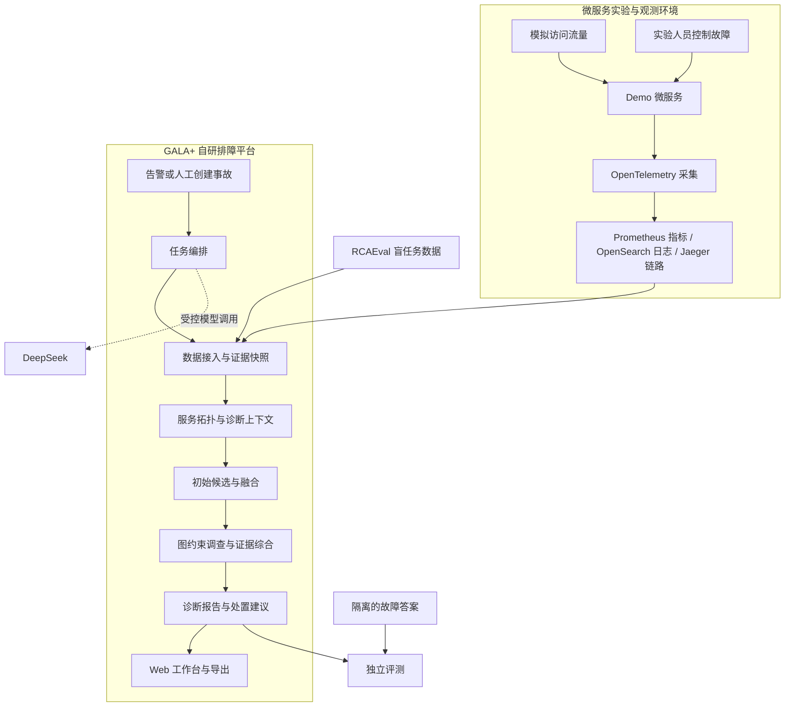

# 01 — 项目框架与模块划分

日期：2026-11-13。状态：架构讨论稿。

本文件依据已讨论的项目方向和前期完整设计草案整理。当前工作区包含论文和设计资料，尚无产品代码；下文“模块”均指计划实现的能力。

## 1. 项目要解决什么问题

项目定位为一个面向微服务的智能排障平台：收到异常线索后，查询指标、日志和调用链，筛选可疑服务，沿服务依赖关系调查，最终给出根因候选、证据说明和处置建议。

一次诊断应让使用者看清：哪里出现异常、哪些服务可能是原因、哪些只是受到影响、判断依据是什么，以及接下来可以采取什么措施。证据不足时，应明确说明缺什么数据或哪些判断尚不确定。

首版主要定位到服务；具备可靠实例标识和对应证据时，再细化到容器/服务实例。真实 Kubernetes Pod 定位属于后续接入能力。首版处置输出为建议，不直接执行重启、扩容或回滚。

已确认的方向：以 OpenTelemetry Demo 作为首个运行环境，以 RCAEval 支持离线回放，后端使用 Python，模型服务商暂定 DeepSeek。React/TypeScript、FastAPI 和 SQLite 等属于前期提出的工程选型。

## 2. 整个项目由哪些部分构成

整体分为三个部分。其中第一、第三部分为开发和验证提供条件，第二部分是我们主要开发的软件。

| 部分 | 组成 | 与项目的关系 |
| --- | --- | --- |
| 微服务实验与观测环境 | OpenTelemetry Demo、流量发生器、故障开关、OpenTelemetry 采集、Prometheus、OpenSearch、Jaeger | 运行被诊断的业务，产生并保存真实遥测；我们负责部署、配置和验证接入 |
| GALA+ 智能排障平台 | 事故管理、数据接入、证据处理、图分析、候选排序、智能体调查、报告和工作台 | 主要自研部分，负责把遥测转化为可核验的诊断结果 |
| 回放与评测体系 | RCAEval 数据、受控故障实验记录、基线算法、评分与实验报告 | 检验诊断效果、成本和失败情况；正确答案仅用于评分 |

DeepSeek 是排障平台调用的外部模型服务。它接收经过整理的诊断上下文，返回结构化分析；业务系统和观测系统的访问由平台控制。

图展示主要数据流。任务编排还负责后续分析阶段的调度；模型调用分别发生在候选融合、调查、证据综合和建议生成中。故障答案没有通向诊断流程的通道。

## 3. 自研平台的十个逻辑模块

这些模块按职责划分，不等于十个独立微服务。首版可以在一个 Python 后端工程中组织，通过清晰接口协作。

| 编号 | 模块 | 主要职责 | 主要输入 | 主要输出 |
| --- | --- | --- | --- | --- |
| M01 | 事故接入与管理 | 接收告警或人工请求，创建、去重和关联事故 | 环境、时间、异常症状、告警对象 | 事故记录、诊断请求 |
| M02 | 多源数据适配 | 按统一接口查询不同遥测后端或读取离线数据 | 数据源配置、实体范围、时间窗口 | 来源数据、查询覆盖与错误信息 |
| M03 | 数据规范化与证据快照 | 统一时间、单位和实体身份，保存固定快照，登记证据 | 来源数据及采集状态 | 标准化遥测、证据索引、数据质量 |
| M04 | 服务拓扑与诊断上下文 | 构建调用图，组织服务及邻居的诊断包 | 快照、候选实体或调查对象 | 依赖图、节点/边统计、诊断包 |
| M05 | 初始候选生成与融合 | 分别分析指标和链路，再形成调查候选 | 指标、图统计、异常摘要 | 初始根因候选、来源与排序依据 |
| M06 | 图约束调查与证据综合 | 调查候选及其相关邻居，整理支持和反证，形成最终诊断 | 初始候选、诊断包、调查预算 | 最终候选排序、证据解释、传播假设、诊断状态 |
| M07 | 报告与处置建议 | 组织事故摘要、三类建议，检查最终报告引用并导出 | 已综合的诊断结果及证据 | 结构化报告、Markdown/JSON 等导出 |
| M08 | API 与前端工作台 | 提供操作入口，展示任务、依赖图、证据和报告，接收反馈 | 用户操作、后端任务与结果 | 可交互页面、API 响应、人工反馈 |
| M09 | 任务编排与模型接入 | 调度各阶段，限制并发与费用，处理取消、重试和模型输出校验 | 诊断请求、配置、预算 | 阶段执行结果、进度、用量、失败记录 |
| M10 | 回放与效果评测 | 驱动同一诊断流程处理固定案例，独立比较预测与答案 | 盲数据、冻结配置、预测结果；评分侧另读答案 | 准确率、拒判/失败情况、耗时和成本对比 |

### M01：事故接入与管理

定义“我们正在调查哪一次异常”。入口包括手动创建、告警规则轮询，以及为后续接入准备的告警 webhook。它负责告警去重和事故关联；任务执行进度交给 M09。

一个事故可以有多次诊断。例如先基于当前数据调查，稍后重新采集更多数据形成另一份结果。事故身份与单次运行身份分开保存，便于比较。

### M02：多源数据适配

面向 Prometheus、OpenSearch、Jaeger 和 RCAEval 分别实现适配器，上层通过一致的查询约定获取数据。数据源的地址、认证、字段形状和分页差异停留在适配层。

OpenTelemetry 等组件负责从业务应用采集遥测；本模块主要负责读取和适配已经采集的数据。后续换日志平台或接入另一套集群，优先增加或替换适配器。

### M03：数据规范化与证据快照

负责让三种数据能够一起使用：统一时间和单位，关联服务/实例身份，区分缺失、查询失败和确实为空，并为原始及派生证据分配稳定标识。

每次运行固定一份快照。后续模型分析、报告引用与回放都基于这份快照，避免一边调查一边读取变化中的数据而失去可复核性。底层读写由共享存储组件承担。

### M04：服务拓扑与诊断上下文

根据调用链构建有向服务依赖图，保留调用方向、延迟和调用量等观测信息。图描述调用关系；是否构成故障传播，还需要 M06 结合其他证据判断。

在候选生成前先提供拓扑和统计；候选产生后，再按需整理每个调查对象的“诊断包”：指标、日志、代表性 spans、一跳邻居和数据缺口。M06 调查邻居时也通过同一模块获取上下文，避免两个流程分别拼装证据。

### M05：初始候选生成与融合

指标侧接入 BARO 排名，链路侧实现 STRIX，以不同信号筛选可疑对象。随后融合两份排名，保留来源和推测的故障类型。指标异常、拓扑位置或模型分数都只形成候选，不能直接当成已确认根因。

按前期方案，融合优先由受控模型角色完成，模型不可用时采用确定性排名融合并标记降级。普通统计、分位数与图分数由程序计算。

### M06：图约束调查与证据综合

对高优先级候选检查证据；需要补充解释时，调查其直接调用方或被调用方。首版主动探索候选的一跳邻域，调查范围和调用次数受 M09 限制。

各调查分支输出支持因素、反对因素和未知项。综合阶段比较候选能否解释整体症状，给出最终排序与传播假设，明确“有证据支持”“暂定判断”或“证据不足”。允许实际调查到的邻居成为最终根因候选。

### M07：报告与处置建议

将诊断整理成可读报告，包含症状、根因候选、关键证据、反证、传播解释、限制，以及立即缓解、永久修复、预防措施。

最终引用必须能定位到快照中的证据。建议缺少前置条件时应明确表达；首版通过报告帮助人工处理故障，变更执行器属于后续独立能力。

### M08：API 与前端工作台

前端拟提供事故列表、创建诊断、事故详情、数据源状态和回放结果页面。重点交互是查看调查进度、点击服务节点检查证据、比较候选、读取建议和导出结果。

FastAPI 提供业务接口，前端采用 React/TypeScript，依赖图使用 Cytoscape.js。浏览器通过 API 操作，模型凭证和遥测后端凭证保存在服务端。

### M09：任务编排与模型接入

内部有两个子模块：任务编排负责排队、阶段顺序、并发、超时、取消和恢复；模型网关负责 DeepSeek 通信、结构化输出校验、调用重试、用量与预算记录。

M05/M06/M07 定义各角色分析什么，M09 负责怎样可靠地执行调用。任务状态需要持久化，浏览器刷新不应丢失进度；模型超时或额度耗尽时，应保留已有证据和明确的部分完成状态。

### M10：回放与效果评测

回放模式复用 M02–M07 和 M09 的诊断能力，只替换输入来源和任务触发方式。它还组织与 BARO、STRIX 等基线的比较，检查智能体调查是否带来实际收益。

故障答案、注入控制信息和人工参考报告只允许评分侧读取。健康案例、拒判和失败也应进入评测记录，以便发现无根据猜测和接入覆盖不足。实验中的故障注入由独立控制面执行，不成为诊断智能体的工具。

## 4. 多智能体具体指什么

“多智能体”在本项目中表示四种分析角色，可以共享 DeepSeek 接入和同一个 worker 进程。调查角色可以针对不同服务并行执行。

| 角色 | 所属模块 | 工作 |
| --- | --- | --- |
| 候选融合角色 Consolidation | M05 | 汇总指标和链路提供的初始线索 |
| 调查角色 Investigator | M06 | 检查某个服务的证据，记录支持和反对因素 |
| 证据综合角色 Evidence Synthesis | M06 | 比较各分支结论，形成整体诊断 |
| 处置建议角色 Remediation | M07 | 根据已形成的诊断生成分阶段建议 |

各角色使用明确的输入和输出格式，由程序校验实体、引用和预算。任务调度、数据查询、统计运算及原始证据登记由程序模块承担。

## 5. 支撑所有模块的公共能力

共享存储组件保存事故、运行状态、结果、配置引用及文件索引，初期采用 SQLite 和本地快照文件。M03 定义证据快照语义，M09 定义任务状态语义，存储组件负责可靠读写。

共享配置组件管理环境、查询规则、提示词与模型参数版本；日志与用量记录帮助追踪每次运行。最终结论统一经过证据检查，区分数据不足和程序运行失败。这些能力作为公共基础复用，不再建立独立业务分析流程。

## 6. 一次诊断如何穿过这些模块

以下为假设场景：结账接口频繁报错，需要判断是结账服务自身故障，还是支付等下游服务导致。

1. M08 接受人工请求，或 M01 接到告警，创建事故和诊断请求。
2. M09 持久化并调度任务，按数据可见时间准备采集。
3. M02 读取相同窗口的指标、日志和调用链；M03 形成固定证据快照。
4. M04 构建服务关系与统计；M05 生成、融合初始候选。
5. M04 为候选按需提供诊断包，M06 调查候选及相关邻居，比较支持与反证；模型请求统一经过 M09。
6. M06 得出有依据的排序或证据不足结论；M07 形成报告与处置建议。
7. M08 展示结果和证据。若属于实验，M10 在诊断结束后读取隔离答案，进行评分。

如果数据最终表明支付服务内部报错，可以把它列为候选原因；如果只是结账服务调用了错误地址，则需要保留调用方配置问题的可能性。模块协作的目标就是让结论建立在可查证的数据上。

## 7. 这些模块实际如何运行

自研应用采用模块化后端：API 和 worker 共用 Python 领域模型与算法包，分别作为接待请求和执行任务的进程。模块不一一对应容器。

| 运行单元 | 承担职责 |
| --- | --- |
| Demo 和观测组件 | 运行业务、产生流量、采集和保存遥测 |
| gala-api | 提供 M08 接口，调用 M01 创建事故，读取任务和报告；提供构建后的前端文件 |
| gala-worker | 执行 M09 调度，并运行 M02–M07 的采集与诊断任务 |
| 告警轮询/评测命令 | 使用 M01 告警规则或 M10 回放能力，按模式启用，调用共同的任务入口 |
| 数据库与快照文件 | 为 API、worker 和受控评测提供持久化 |
| DeepSeek API | 外部模型推理服务 |

开发时前端可以单独启动。首次部署计划沿用 Docker Compose；进程数、端口、资源限制和具体启动命令在部署主题中展开。

## 8. 本批设计形成的框架

首版围绕“外部实验与观测环境 → 自研排障平台 → 独立效果评测”组织，平台内部采用上述十个逻辑模块。在线诊断和离线回放共享核心，报告能回到原始证据，诊断任务与故障控制、真实答案隔离。

下一批建议细化实验环境与数据接入：需要启动哪些组件，三类数据分别如何获得，如何确认采集成功，以及适配器向平台交付什么。后续批次再确定具体字段、API、算法参数和验收门槛。

模块的具体推进先后见[推进顺序与阶段交付](development-sequence.md)，其中按数据依赖细化首版里程碑。

设计依据：[前期完整设计草案](../superpowers/specs/2026-11-09-gala-system-design.md)中的架构、数据契约、诊断算法、API、任务管理和评测章节。本批没有改变此前的核心路线，而是建立便于逐模块讨论的结构。
