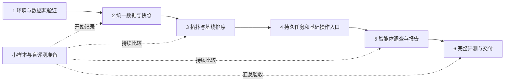

# 推进顺序与阶段交付

日期：2026-11-13；流程更新：2026-11-16。状态：全局推进路线已获用户认可，各阶段设计及交付逐一审查。

本文解释[十个逻辑模块](01-architecture-and-modules.md)的开发先后关系，细化前期设计的 M0–M3 里程碑。模块编号 M01–M10 表示职责；里程碑 M0–M3 表示交付阶段，两者含义不同。

## 1. 推进原则

按依赖和风险安排顺序：先取得可信数据，再建立可重复的排序基线，随后建设可靠的执行入口，最后接入智能体并完成效果评测。每一阶段交付一个能独立运行、可检查结果的小流程，已有模块随阶段逐步补全。

每个新阶段先交付包含六个固定章节的完整阶段设计，等待用户确认后才开发。阶段完成提交成果供用户审查；不通过则留在本阶段修改。审查通过后，仅一两句话说明下一步方向，不展开下阶段方案或任务；启动下一阶段时重新走设计确认流程。详细规则见根目录 [AGENTS.md](../../AGENTS.md)，首阶段方案见 [M0 设计](stages/m0-design.md)。

事故对象、任务参数、配置和存储需要最小基础。早期可以通过 Python 命令行输入环境、时间窗和症状，逐步加入 API、持久任务和界面。评测从第一个可运行的算法开始记录，答案始终与诊断输入隔离。

## 2. 推荐顺序

| 顺序 | 对应里程碑 | 重点模块/工作 | 阶段交付与完成标志 |
| --- | --- | --- | --- |
| 1 | M0：环境与接口验证 | Demo 与观测组件；M02 数据源探测 | 业务可访问；能够查询对应时间窗的指标、日志和完整链路；有固定版本及真实响应样本。模型调用在后续模型接入阶段验证 |
| 2 | M1 前半：可信数据 | M02 多源适配、M03 规范化与快照；M01/M09 的最小运行参数；M10 盲数据导入 | 能将一次真实事故及一个离线案例分别保存为统一快照，重新读取后时间、实体、单位与证据一致 |
| 3 | M1 后半：确定性基线 | M04 拓扑与上下文、M05 指标/链路排序；M07 简单导出；M10 基线计分 | 命令行输入事故后，输出调用关系、候选排序和引用证据；同一快照重复运行结果一致，并得到首份基线记录 |
| 4 | M2：可靠任务与操作入口 | M09 持久任务、M01 事故/告警规则、M08 API 与基础界面 | 可创建任务、查看状态和基线报告、点击证据；告警可创建事故；取消、重试、重启后状态可解释 |
| 5 | M3 前半：智能体诊断 | M09 DeepSeek 网关与预算；M05 模型融合；M06 调查与综合；M07 完整报告 | 依次接入分析角色，能调查候选与邻居，生成可追溯结论和分层建议；模型失败或证据不足时有明确结果 |
| 6 | M3 后半：完整验证与交付 | M10 配对评测、M08 交互完善、全流程可靠性与部署文档 | 完成固定故障和健康对照、基线/完整流程对比、费用与耗时统计；具备可重复启动和演示的首版 |

第 4 步的基础界面服务于真实任务和已有基线结果；第 6 步再补全候选比较、报告阅读与回放结果等交互。完整功能的验收条件仍参考前期设计，不将阶段性演示当作全部能力已完成。



## 3. 第一步如何展开

对当前项目，先完成实验环境与数据接入设计，再按下面顺序验证条件：

1. 检查 Docker/WSL2、资源和镜像获取条件，确定采用的固定 Demo 配置。
2. 启动业务及所需观测组件，产生正常访问流量。
3. 实际发起一次结账等跨服务请求，在 Jaeger 找到对应链路，在日志后端找到相关服务日志，在 Prometheus 查询相关指标；无 trace ID 的日志只作服务和时间相关线索。
4. 在受控环境开启一个明确的故障，观察正常、故障和恢复阶段的数据变化，记录时间和数据缺口。
5. 用最小 Python 读取程序拿到上述响应，保存为后续适配器开发的样本。

这一步的交付是可用的数据来源和被核实的查询契约。仅能打开 Grafana 或 Jaeger 页面，还不能证明三类数据能够交给算法共同分析。

RCAEval 离线读取在后续数据接入阶段展开，和在线读取进入同一核心流程。如果本地容器环境暂时卡住，继续在 M0 内解决并提交受阻情况；如需改为离线优先，先修订当前阶段范围并等待用户确认，不直接跳入后续阶段。

## 4. 第一个算法原型长什么样

前几步先形成下面这个可运行流程：

```text
输入环境、事件时间和症状
  → 查询遥测或读取盲案例
  → 保存标准化快照
  → 构建服务调用图
  → 指标排名、STRIX 和确定性排名融合
  → 输出候选服务、证据引用和数据缺口
  → 评分侧与隔离答案比较
```

早期 M05 先运行统计排序和确定性融合，M07 先用模板导出 JSON/Markdown，建立比较基线；到第 5 步再加入模型融合和智能报告。这是逐步实现同一设计，并保留原始基线供比较。

这个原型可以通过命令行运行。数据、图和排序形成后，界面和智能体各自有稳定输入，也更容易判断问题来自数据接入、算法还是模型。

## 5. 智能体内部也有先后顺序

第 5 步开始前，M09 应具备基本的凭证读取、调用预算、超时及 JSON 校验。随后按以下顺序接入：

1. M05 候选融合角色：先确认模型能基于两份排序返回合法候选及来源。
2. M06 单个服务调查：只给一个服务的诊断包，验证支持/反证是否引用真实证据。
3. M06 多候选及一跳邻居调查：增加并发、共享结果和停止规则，观察是否能补充初排遗漏的原因。
4. M06 证据综合：比较分支解释和反证，输出最终排序或证据不足。
5. M07 处置建议：基于已形成的诊断生成立即缓解、永久修复和预防措施。

每新增一个环节，都在相同快照和开发案例上与上一版本比较，记录正确性、引用合法性、用量及失败。冻结评估集与开发校准样本分开，避免根据最终测试答案反复调整。

## 6. 哪些模块需要贯穿全程

| 模块 | 早期实现 | 后续补全 |
| --- | --- | --- |
| M01 事故管理 | 事件 id、环境、时间和症状 | 告警去重、恢复关联、多次运行 |
| M07 报告 | 排名、证据和质量信息的模板导出 | 智能摘要、分层建议、完整引用校验 |
| M08 API/界面 | 核心基线可用后提供基础任务与结果页 | 依赖图交互、候选比较、反馈和回放结果 |
| M09 执行基础 | 配置、运行参数、阶段日志 | 持久任务、租约、并发、模型预算和恢复 |
| M10 评测 | 小型盲案例、独立答案、基线记录 | 批量对比、重复实验、健康窗口和完整报告 |

因此，“某模块在后面完善”不表示前期没有它的基础能力。特别是 M10：初版候选排序产生时就应能评分，完整批量实验在最终交付前完成。

## 7. 阶段完成后的决策

每一阶段检查四项：可运行的输入输出、保存的实际样本/结果、明确的失败和缺失状态、下一阶段所需的接口。如果数据无法正确归属到服务，就先修映射；如果调用图错误，就先修链路解析；如果模型改善有限，就通过评测定位问题。

具体工期应在环境与数据接口验证后，根据实际工作量估计。当前路线先确定依赖和交付标志，后续再把每阶段拆成文件、接口和实施任务。
