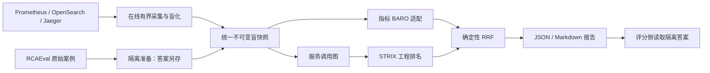

# M1 本阶段设计方案文档：可信数据与确定性诊断基线

日期：2026-11-17。版本：0.1。状态：**设计待用户确认；尚未开始 M1 开发**。

阶段入口：[设计目录](../README.md)。全局依据：[框架与模块](../01-architecture-and-modules.md)、[推进顺序](../development-sequence.md)、[前期完整草案](../../superpowers/specs/2026-11-09-gala-system-design.md)。本方案中的具体实现选择均为本次提案，随整份方案确认后冻结，不冒称此前已经批准或验证。

2026-11-17，用户在 M0 完成情况讨论后明确“ok，那就M1走起”，记录为 M0 交付审查通过及启动 M1 设计。**这不等于本方案已经确认**。本轮仅阅读资料和编写文档，不安装依赖、不下载遥测、不启动实验栈、不创建产品骨架。

## 1. 阶段概述与目标

### 1.1 解决的问题

M0 证明接口可读；其探针归档没有统一实体、盲化、不可变证据或诊断排名。M1 将在线与离线数据变为可核验的同一种快照，在同一核心流程中构图、排序、引用证据并导出报告，建立以后判断智能体是否改善结果的基线。

M1 同时包含既定路线的“可信数据”和“确定性基线”两部分，内部按依赖推进，不拆成额外里程碑，也不以完成导入器代替整个 M1。

### 1.2 核心交付物

1. 带版本的事故、实体、指标、日志、span、质量、证据、快照及报告契约。
2. Prometheus、OpenSearch、Jaeger 在线适配器和 RCAEval RE2-OB 离线适配器。
3. 明确隔离答案的导入准备工具、不可变快照存储及证据校验能力。
4. 服务调用图、固定 RCAEval BARO 适配、STRIX 工程实现、两模态确定性 RRF。
5. Python 命令行入口及 JSON/Markdown 报告；不依赖模型也能运行。
6. 六例固定开发样本、在线事故/健康对照、独立计分和本阶段验证记录。

### 1.3 方案路径及技术选择

既定路线已经选定“数据与算法先行”。仅做数据导入不能满足 M1 交付；先做 API/界面会将 M2 前移；先接模型会失去可重复对照。因此本阶段采用以下单一路径：



| 用途 | 本阶段提案 | 原因与边界 |
| --- | --- | --- |
| 运行时、入口 | Python 3.11；标准库 argparse；命令名 `glide` | 与 M0 一致，不增加 CLI 框架 |
| 工程与契约 | uv、pyproject.toml、uv.lock；Pydantic 2 | 在获批后的项目虚拟环境内安装，不修改系统 Python |
| 有界 HTTP | HTTPX AsyncClient；标准库 asyncio | 并发、流式限量读、全程截止；不增加后端 SDK |
| 数值与图 | NumPy、pandas、scikit-learn、NetworkX、SciPy | 沿用全局方案；SciPy 支持 PageRank 的实际依赖 |
| 离线文件 | PyArrow Parquet 读取 | 官方按案例分发 Parquet，无需装完整 RCAEval 环境 |
| 持久数据 | 本地 JSON/JSONL + manifest + SHA-256 | M1 单次 CLI 流程无需任务数据库；不提前加 SQLAlchemy/队列 |
| 验证 | pytest、Ruff；保留 M0 unittest | 测试纯逻辑和边界，真实后端验证单独执行 |
| 模型、界面 | 本阶段不引入 | DeepSeek 保留到 M3；API/基础界面保留到 M2 |

以上是依赖家族选择，尚未完成本机兼容验证。获批后解析 Python 3.11 可用的具体版本并提交锁文件，报告实际版本；不得在结果间静默升级。算法提取保留来源、许可证与差异说明，不复制整个第三方仓库进业务包。

## 2. 工作范围

### 2.1 需要实现的内容

| 能力模块 | 本阶段实现深度 | 交付边界 |
| --- | --- | --- |
| M01 事故 | 环境、时间、症状、可选入口服务、窗口策略 | 手工/known_onset 输入，不实现告警状态机 |
| M02 适配 | 三个在线后端 + 一个固定离线格式；能力探测、有界查询 | 不追求任意监控平台接入 |
| M03 规范化/证据 | 实体、时间、单位、质量、盲化、不可变存储 | 保留缺失事实，不补造观测 |
| M04 拓扑 | 跨服务同步调用图、节点/边统计与一跳上下文 | 不推断不存在的依赖和因果边 |
| M05 排序 | 指标路径、STRIX 三维、两层 RRF、异常准入 | 不调用 LLM，不将排名叫根因证明 |
| M07 导出 | 模板式 JSON/Markdown，证据及数据缺口 | 不生成模型解释或自动修复建议 |
| M09 执行基础 | 配置、单次运行、阶段时间、资源上限、退出状态 | 不实现常驻 worker、租约、并发任务平台 |
| M10 回放/评分 | 六例开发子集，答案隔离，三个基线分别评分 | 不以小样本声称论文复现或完整准确率达标 |

### 2.2 明确不做的内容

- 不做 FastAPI、Web 前端、用户系统、任务数据库、告警扫描器、自动重试任务或多进程服务。
- 不做 DeepSeek 接入、模型融合/调查/建议、向量库、RAG、自动执行处置。
- 不升级 M0 镜像、不增加日志平台、不改上游业务 SDK，不删除或重建 OpenSearch 旧容器/索引。
- 不下载全量 RCAEval；不使用 repeat 2–3 调参，不开展 TT/AegisLab、alert_replay 或 M3 完整矩阵。
- 不实现完整 BARO BOCPD 起点检测，也不把独立 STRIX 实现称为作者闭源代码复现。
- 不为缺少 span.kind 的离线数据猜造 SERVER；不自动猜测未知单位、服务后缀和故障答案。
- 不提供自动清理、覆盖快照、通用插件框架、远程部署或 Kubernetes 适配。

### 2.3 实施顺序与阶段内交付

获本方案确认后依次推进：①契约/窗口/边界测试 → ②离线准备、规范化与快照 → ③在线适配和新事故采集 → ④拓扑/BARO/STRIX/RRF → ⑤导出/盲计分/完整验收。每步保持已有 M0 检查可运行。

这只是本阶段依赖顺序，不是现在开始开发的授权，也不逐项新增审批门槛。整个 M1 开发完成后统一提交审查；遇到必须改变本方案范围、契约或验收的事实，先修订方案并重新确认。

## 3. 与上一阶段对接说明

### 3.1 复用的 M0 成果

| 成果 | 已验证事实 | M1 如何复用 |
| --- | --- | --- |
| 固定实验栈 | Demo 3.1.0，源 `dedc0178918e260823323b8d95005a8cb924b007`；25 容器 | 沿用 runbook 及配置，不另造微服务环境 |
| 本机预算 | Docker 约 8 GiB；两个 Go 服务各 128M，Grafana 384M；实测容器峰值约 3.80 GiB | 单 CLI、并发 2；处理新增资源单独实测，不能据此承诺总资源已足够 |
| 三类接口 | Prom query_range；OpenSearch search/mapping；Jaeger v3 services/traces/detail | 用现有样本核对字段；正式代码放独立业务包 |
| 日志修复 | `otel-logs-v2-*`、`glide-m0-logs.v2`，13 个真实服务及异构日志验证 | 只读新前缀；不把 25 容器均称作已采集日志 |
| 工具与回归 | `m0_probe.py`、`m0_logs_setup.py`、34 项单元测试 | 继续作为实验验证工具，不扩成平台核心，不破坏原调用契约 |
| 历史样本 | 含真实响应、实验操作真值和资源记录 | 仅作接口取证；不能直接输入算法或冒充完整盲快照 |

M0 交付记录：[初始验证](../../delivery/m0-validation.md)、[日志修复](../../delivery/m0-log-ingestion-fix.md)。归档后实验容器已停止；Jaeger 内存数据已丢失。M1 获批后必须重新运行受控实验取得新快照，不承诺从后端恢复旧 trace。

### 3.2 必须保持的接口语义

- OpenSearch 查询字段是 `resource.service.name.keyword`；响应读取 `_source.resource["service.name"]` 的字面键。`severity` 是对象；结构化 body 已由 SS4O 变为 JSON 字符串。
- `@timestamp` 是事件时间；`observedTimestamp` 是当前 exporter 生成的时间，不称原始 OTLP 观察时间。二者保留 ns 精度。
- 自由 `attributes` 和 scope 属性只存在 `_source`，不能承诺按任意子字段过滤/排序。不得为分页偷偷更改 M0 mapping。
- Jaeger 实测 `kind` 为数字；用 OTLP 枚举解释，status 的 UNSET/OK/ERROR 与 HTTP/gRPC 业务码分别保存。合法短 hex ID 只可按明确规则左补零，禁止转数值和截断；全零/非法长度记录错误。
- M0 的 RED `sum(...)` 响应可为 `labels={}`。M1 查询必须保留 `service_name` 分组，或用明确单服务绑定归属；无归属不能合并成“unknown”服务。
- `container_cpu_utilization_ratio` 不可仅凭后缀按 0–1 解释。保留原始值作辅助；主 CPU 序列采用已校准的 `rate(container_cpu_usage_nanoseconds_total[1m])/1e9*100`，单位为单核百分比，多核可超过 100。内存使用 bytes。
- ns 解析不能复用 M0 中浮点 `datetime.timestamp()` 的查询转换；新的精确时间函数独立实现，M0 脚本保持兼容。

### 3.3 不得改动的内容

不覆盖原始 artifacts、实验失败记录、私有配置和用户改动；不清空旧索引，不搬动第三方源码，不改三个回环发布端口和固定镜像。M0 配置、脚本、测试保持行为不变；只允许补充文档链接/状态。若后端缺陷阻挡 M1 且必须改动这些约束，先提交变更设计。

## 4. 关键细节与注意事项

### 4.1 统一契约与依赖方向

单 Python 包 `gala`，在线/离线在适配入口不同，规范化之后共用快照、图、排序、导出。核心不导入准备/评分模块，不访问网络和答案目录。M1 不预建 M06、API、worker 等空模块。

| 对象（schema 均从 `.v1` 起） | 必需字段及语义 |
| --- | --- |
| IncidentInput | 随机 incident_id、environment_id、protocol、incident_time_ns、created_at_ns、可空 symptom/entry_entity、window_policy_version；症状不得包含注入类型/参数 |
| EntityRef / MappingEntry | 主键 `(environment_id, service_namespace, service_name)`；源身份、映射版本/依据、有效起止时间；实例信息附属保存 |
| MetricSeries / Point | series_id、entity、源查询/标签、semantic_type、source_unit、unit、conversion_version、native_cadence_ns、lookback_ns、timestamp_ns、有限数值、质量/源定位 |
| LogRecord | entity 或 unresolved、event_time_ns、可空 observed_time_ns、severity、body、attributes、可空 trace/span_id、源定位 |
| SpanRecord | entity 或 unresolved、trace/span/parent_id、kind、start/end/duration_ns、status及其编码体系、attributes、links、source_resolution_ns、完整性/排除原因、源定位 |
| SourceResult / Quality | 来源/模态/实体/时段、status、completeness、计数、分页/截断/错误、可见性模式及选择策略 |
| Evidence | evidence_id、entity、时间范围、source_locator、payload_digest、transform_version、派生 parent_ids；只引用当前快照 |
| SnapshotManifest | snapshot_id、schema/策略/映射版本、窗口、实体/质量、文件相对路径/字节数/hash、内容摘要；不含凭证或答案 |
| DiagnosisReport | snapshot/hash、方法/依赖/配置版本、图和三套排名、有效异常、证据、质量、结果状态；耗时放独立运行记录 |

Python 内部时间为 int ns，JSON 的 epoch、duration 与大整数均用十进制字符串；小型计数和浮点度量保持 JSON 数字。解析拒绝 NaN/Inf、负时长、越界时间及非法枚举；不能因一个坏行丢弃整源而不报告。必需顶层/时间单位不匹配则该源失败；可隔离的坏行记录排除数和原因。

身份只使用版本化显式表。Demo 与 RE2-OB 是不同 environment；RE2-OB 的 `frontendservice→frontend` 仅在其固定版本别名表生效。namespace 缺失用环境默认 `default` 并标来源。未解析身份保留记录但不能排名；映射冲突不任选其一。container、Pod、服务不能互相替代。

### 4.2 时间窗口、采样与可见性

沿用全局策略，令 τ 为 incident_time，C 为创建时间：

```text
事件窗：[τ−10min, as_of]
正常段：[τ−10min, τ−2min)；guard：[τ−2min, τ)
异常段：[τ, as_of]
min_cutoff = ceil_to_10s(τ) + 30s
as_of = min(τ+5min, max(C−15s, min_cutoff))
ready_at = max(C, as_of+15s)
```

手工历史 as_of 只可处于 `[min_cutoff, τ+30min]`，并不晚于执行时已可见截止。离线 `known_onset` 的模拟 C=τ，默认 as_of=min_cutoff；不因实际执行日期/速度扩大观测。`τ` 是该协议允许的已知起点，不声称实现自动检测。

M1 CLI 在 ready_at 前等待且可 Ctrl+C。继承采集及诊断实际工作合计300秒预算：采集/盲化/发布阶段最多240秒，诊断/导出最多60秒，均以monotonic时钟计时、含重试与发布；离线原文件获取是准备环境操作，另记耗时。两个CLI命令间人工停留不计工作时间，不能移动已固定窗口；不把预算解释为采集和诊断各300秒。超时不能发布看似完整的结果。

10 秒桶按 UTC epoch 对齐，为 `[b,b+10s)`；只取整个桶都在其对应正常/异常段且右端≤as_of 的桶。恰在右端的观测归下一桶，as_of 上的点可留作证据但不进入尚未完整桶。guard 只作上下文，不拟合正常值或计算异常排名。

指标同桶取合格观测的算术均值，保留原始时间/频率；正常拟合和异常评分均用这一10秒桶视图，不能一边原生点、一边桶最大值。不补零、不跨缺口前填、不跨截止插值。**query_range的评估时间不等于源采样时间**：在线适配对每类冻结表达式同步查询 `timestamp(底层counter/gauge)`；复合RED表达式保存所有参与源系列的labels+最新样本时间向量。同一向量仅第一次评估点可准入，源向量未前进或无法取得时不算新观测；值相同但源时间前进是有效新观测，禁止按值去重。原生采样时间、新鲜性证据和评估时间分开保存。未来源时间也须≤as_of。

正常须至少20个不同源时间向量的真实观测、至少20个有效完整桶且期望原生采样槽覆盖≥80%；异常须至少3个有效完整桶。RED原生约60秒、容器约10秒，按已核实cadence查询；60秒点之间不生成持有值，只有该点所在10秒桶有值。8分钟正常段常不满足RED的20点，必须标不合格，不降低门槛。派生rate的lookback可以包含更早历史，但所属段按评估时间判定，绝不读取评估点之后数据；记录lookback，guard不保证消除所有滚动统计污染。

原生间隔c在允许表显式指定并由接口/配置核实；离线从严格递增time序列核验，中位正间隔与变化范围写质量。覆盖槽以UTC epoch为零相位，取完全落在正常段的 `[k*c,(k+1)*c)`；期望数为这些槽数，有至少一个新鲜真实观测的槽为有效槽，每槽至多计1，coverage=有效/期望。另计20个不同源向量/原生点和20个有效10秒桶，不能用高频挤在少数槽内凑数。无可靠频率/源时间时coverage=unknown、不准入。counter重置用正确rate处理，不将负差值当下降证据；0分母、缺失错误序列分别为缺失，不补出健康0。

所有模态先裁剪再统计。事件时间>as_of 排除；存在 observed/ingestion 时间时也须≤as_of。span按start归桶，只有start位于对应段、end不晚于该段右界才进入该段统计；跨正常/guard/异常边界者仅上下文。span结束>as_of标未完成，不计完整时长；父span在窗外不伪补。边界为exclusive的源API查询可扩大1ns再按统一契约裁剪。Prom/Jaeger及离线缺少可靠入库时间时记 `event_time_only`，不声称复现当时真正可见数据。RCAEval的时分展示列禁止作epoch。

### 4.3 在线适配、有界读取与质量

统一适配函数为 `probe_capabilities`、`list_entities`、`fetch_metrics`、`fetch_logs`、`fetch_traces`；不支持的模态显式返回 unsupported。调用仅接受验证后的配置端点和窗口，查询文本从冻结模板产生，不接受任意脚本。

| 来源 | 查询/转换 | 完整性与风险处理 |
| --- | --- | --- |
| Prometheus | query_range；CPU、内存、SERVER请求率/错误率/P95；按服务保留标签；JSON 浮点时间以 Decimal 解析 | 保留 warnings/缺测、真实采样频率、rate lookback；空 series≠数值 0 |
| OpenSearch | v2 前缀、事件/观察截止和服务约束；读取 `_source`；按模态/时段分页 | 实施时核实固定 3.7.0 PIT+`search_after`及 PIT 唯一排序键；不直接按 `_id` 排序。PIT 不可用/失效或无法稳定分页时有限单页并记 partial/unknown，不能宣称全量 |
| Jaeger | 固定 2.19 v3 services/search/detail；按服务及正常/异常固定 30 秒时间片搜索，去重 trace 后读取详情 | 无通用稳定游标、搜索顺序无保证；显式 searchDepth=100。达到搜索限制记 truncated，未达到也不能证明 complete；v3 单 JSON 包装按实测解析，未知响应格式明确失败 |

上述分页策略允许诚实的 partial，不改变全局架构，也不绕过验收中的“需要完整 trace 才能计算”的条件。能力探测记录后端版本、PIT支持/排序、source kind、单位/频率及检索限制；此处在线分页能力尚未在 M1 实际验证。

每次 I/O connect/read/write/pool 超时 10 秒，另外受全程截止限制。网络/429/5xx 最多重试一次；Retry-After 只在剩余预算内采用，其他 4xx 不重试。并发≤2。HTTP 客户端禁用环境代理与重定向；M1 只允许明确配置的回环 HTTP 地址，拒绝 userinfo、片段和任意宿主 URL；以后真实环境接入另做安全设计。

单快照上限：**200 条指标系列、20,000 spans、2,000 logs、50 MiB 解压后的源响应字节**。流式限量读，不在读完无限响应后才数大小；离线 Parquet 按批解码并计源形态重序列化字节，同样有界。下载原文件大小另计，不是快照额度。

spans/logs 配额按正常 40% / 异常 60% 划分；guard 不额外请求，已有响应中的 guard 可保存为上下文但计正常额度。响应字节同为 40% / 60% 保留，正常不得借用异常份额。指标系列先按允许表和实体 key 固定选择，再保留两段样本；其字节计各段额度，公共元数据计正常段。

各段按服务key轮转；先按时间+稳定源ID确定有界统计样本，再在剩余证据额度优先保留已返回的首次错误、极端延迟和代表正常。后者标 `evidence_only`，不回流错误比例/P95/STRIX统计。trace整条接纳，单条超过剩余额度则整条跳过并记录，不为凑数拆成“完整trace”。预算止于搜索/详情任一环节时记录发现数、读取数、跳过数及采样偏差；相同snapshot排序固定，不承诺两次查询结果相同。

查询覆盖完整性、被接纳trace内部完整性和统计母体代表性分别记录。未能证明某时段请求总体完整，或发生按症状偏选时，不用该样本的错误比例/P95触发绝对异常门槛；仍可展示样本分布并标偏差。Jaeger搜索顺序/覆盖未知时链路异常准入可能整体不可用，但已完整读取的trace仍可支持有前提的维度计算；不能为了出榜伪称总体完整。

`status=ok/empty/unsupported/partial/error` 与 `completeness=complete/truncated/unknown` 独立保存；空数据只有查询有效才是 empty。质量细化到服务×模态×正常/异常，计返回、接纳、重复、坏行、未来、盲化排除、失败和未知总量。HTTP200/少于上限/无孤儿 span 都不足以认定完整；原始总数未知时写 null 与 unknown。

### 4.4 离线资源、字段及答案隔离

代码参考固定 [RCAEval `90b63a4`](https://github.com/phamquiluan/RCAEval/tree/90b63a46ac1e969f1fa9015318b51e455c62f8c4)；官方数据固定 [HF revision `afeacb1`](https://huggingface.co/datasets/phamquiluan/RCAEval/tree/afeacb11bcc94dadfd1c8f483ee4377b2b8b614e)。版本/文件树已核实，**遥测文件尚未下载和逐案解析**。

RE2-OB 90 例中 repeat1 的 30 例为开发区；repeat2–3 的 60 例封存至 M3，不读取其遥测调参。M1 固定下列六例，覆盖六类故障和五个服务。原始名字只允许存在于准备/评分侧清单，不传给诊断函数、报告或证据 locator：

| 准备/评分侧原始案例 | 四文件元数据合计字节 |
| --- | ---: |
| re2ob_checkoutservice_cpu_1 | 10,640,955 |
| re2ob_currencyservice_mem_1 | 10,263,742 |
| re2ob_emailservice_disk_1 | 10,505,978 |
| re2ob_productcatalogservice_delay_1 | 9,911,429 |
| re2ob_recommendationservice_loss_1 | 8,484,538 |
| re2ob_checkoutservice_socket_1 | 10,689,284 |

四文件为 metrics/logs/traces.parquet 与 inject_time.txt，合计 **60,495,926 字节，约57.7 MiB**，不含缓存和生成物。准备工具仅获取这些固定版本文件；校验尺寸/可取得的 LFS hash，并计算本地 SHA-256 写锁定清单。未取得外部可信 hash 时明确 TOFU，不冒称第三方完整性已证明。失败不换案例。

HF 不可用时允许人工选择官方 [Zenodo RE2-OB.zip](https://zenodo.org/records/14590730)，记录大小 1,191,025,569 bytes、MD5 `b9e23f8842c404b396ffd2becff15de4` 并计算 SHA-256；只提取同六例，经语义一致性核对后方可使用，拒绝压缩路径穿越/超限解压。默认不自动下载该大包；不能切到全 RE2 或另一数据版本。

| 模态 | 固定版公开字段依据 | 导入规则 |
| --- | --- | --- |
| 指标 | time：Unix 秒；服务_指标列 | 显式列映射 semantic_type；源单位尚未知可记 `unknown`，仅同一序列的稳健相对变化可用，禁止套在线绝对阈值；未确认升高含义的列只展示 |
| 日志 | timestamp：ns；container_name、message，附加字段可能不同 | 必需列校验，正文及可选字段保留；不凭 error 文本推测真值 |
| trace | traceID/spanID/parentSpanID、serviceName、operationName、startTime/duration：µs；startTimeMillis：ms | 以整数转 ns，交叉核对两个起点；time 的 HH:MM 仅展示；statusCode 按源 gRPC 体系保存，null≠成功 |
| 缺失能力 | 公开 trace schema 无 span.kind，未证明实例/Pod 身份 | kind=UNKNOWN；服务级粒度；延迟/错误 SERVER 统计 unavailable，不按 operationName 猜造 |

字段依据是固定版 [notebook](https://github.com/phamquiluan/RCAEval/blob/90b63a46ac1e969f1fa9015318b51e455c62f8c4/docs/multi-source-rca-demo.ipynb) 与 [OTLP 转换代码](https://github.com/phamquiluan/RCAEval/blob/90b63a46ac1e969f1fa9015318b51e455c62f8c4/RCAEval/convert/otlp.py)。下载后必须逐案核实实际 schema、时间、ID、映射及单位。公开缺失能力按本方案表达；若实际格式不同或必需时间/身份无法核实，该路径停止，不自动猜格式。

准备侧读取原始目录、cases索引、inject_time和答案，生成随机case_id、普通τ及盲化数据；`case_id→原路径/根因/故障类型/重复号`只写评分区。准备侧打开三个遥测Parquet文件，把句柄与随机file_id传给离线适配器；适配器只解析给定遥测流，不接目录名/答案/注入文件。经规范化/盲化后发布JSONL快照，诊断只读该快照，不读取Parquet原件、cases.parquet、注入配置、参考报告及原始名字。known_onset允许τ，禁止额外透露注入说明。

盲化采用版本化允许字段投影与精确排除表：排除flagd、flagd-ui控制服务、feature-flag评估span、注入开关属性/控制日志、实验标签/路径及敏感凭证；保留业务错误/延迟/资源症状。新增源只投影契约声明字段；其他属性默认不进入盲输入，原始取证留隔离区。实施时把实际键映射到这些既定类别、形成带版本清单并配泄漏fixture，不根据故障答案另选业务症状；需要新增诊断字段或改变排除类别则修订方案。已允许正文内精确命中控制标记的整条控制记录排除，普通业务错误正文保留；未知疑似控制信息隔离报告，不直接放行。

不因排除控制 parent 重新接边；被排除与采集缺失分开计数。影响下游可见性的删减使 leaf 判定不可用。诊断只打开盲根目录内的相对文件，准备/评分为独立 CLI 命令和模块边界；这是逻辑隔离，不声称同一用户权限下构成操作系统安全沙箱。

### 4.5 不可变快照、证据与文件安全

快照中的 `source/` 保留经过盲化的源结构，绝不指向含答案的原始实验档案；规范化文件与其逐行/文档/span 对应。原始数据在隔离区，删除/修改后端不影响已发布快照。

先随机分配 snapshot_id；源定位使用随机 file_id+行/文档/trace/span 键，不含真值目录。证据 ID 沿用全局公式：`SHA256(schema_version + snapshot_id + canonical_locator + transform_version + payload_digest)`；拼接实际采用有字段名的规范 JSON 数组编码，避免歧义。对象 key 排序、UTF-8、无多余空白，拒绝非有限数字；派生证据登记 parent_ids，先写原证据再写派生证据。

新目录独占创建：在同一文件系统 `.pending-<uuid>` 写入 → 校验 schema/路径/额度/证据 → 逐文件 flush/fsync 和 hash → 最后写 manifest → 原子 rename 到随机 snapshot_id 目录。禁止覆盖同名目标、覆盖旧 manifest、跟随目录符号链接/junction 越界。Windows 目标占用/rename 失败只留未发布临时目录并返回失败，不回退到覆盖复制。

manifest 列每个数据文件相对路径、字节数、SHA-256；自身不列为输入文件。`content_digest` 基于不含自身摘要/执行墙钟的规范 manifest 核心和文件 hash，避免自引用。读取先核路径包含性、重解析点、文件大小/hash、版本和引用闭包，再交给算法。损坏文件拒绝诊断，不悄悄重拉网络。

同一快照重复运行证据 ID、图、排名及报告业务字段稳定；新采集可有新 snapshot_id/证据 ID，不要求不同采集字节一致。运行时间、墙钟、运行 ID 单独记录，不混入可重复比较内容。

本机快照配额默认 5 GiB，30 天是人工保留建议；无自动删除。发布前检查当前快照总量、磁盘剩余及本次上限，超限拒绝新增并提示人工处理；不删除旧快照腾空间。单 CLI 锁阻止同一数据根的并发发布/配额竞争；异常退出锁需核实进程状态后人工恢复。

### 4.6 调用图与完整性

按 `(trace_id,span_id)` 去重，相同 ID 冲突 payload 进入质量错误，不任意覆盖。只在同 trace 找 parent，跨服务建立 caller→callee，允许环；CLIENT→SERVER 双端不重复计 RPC，SERVER 时长优先。同服务 INTERNAL 可沿已存在 parent 链找最近跨服务祖先，但不跨越缺失/排除节点补造关系。links 仅作关联证据。

CLIENT-only 只有显式已核实 peer 映射才保留客户端观测边；缺 kind 的离线父子边可构造已观测拓扑，但不当 SERVER 调用样本。图记录 observed_relation、时段、计时口径、计数和 span 证据，区分拓扑边数与合格 RPC 数。

节点/边分别保存合格调用数、mean/P50/P95/P99/sum 和父证据。全事件窗拓扑供探索/centrality，正常段统计单列，异常段完整 SERVER spans 供 STRIX。首版不从无边推断无下游。

`trace_completeness=complete` 必须有实际保证：完整 detail 响应未截断、窗内统计所需 ancestry 完整、无未知/排除下游、相关服务插桩能力已核实。源无法保证时为 unknown；无孤儿并不能单独证明完整。只有满足这些条件且无观测下游者可叫 observed_leaf，未知则 Impact unavailable。

### 4.7 指标 BARO 适配与异常门槛

分开输出两种方法，均接收相同冻结的10秒桶视图与窗口；对照按相同cadence分组/单系列处理缺测，不填零或跨系列插值，其格式适配差异写入方法元数据：

- `baro_rcaeval_pinned`：固定 RCAEval 版本的统计排名对照，保留其预处理/RobustScaler 行为，单独记录删列；不作为异常准入依据。
- `baro_engineering_v1`：同样正常段拟合、异常段取最大有符号稳健偏移；增加质量、常量、实际异常门槛，用于工程候选。

对照参数固定：离线 `dataset="re2-ob"`，在线 `dataset="glide-demo"`（同一非None预处理分支）；`dk_select_useful=False, anomalies=None, inject_time=τ`。仅拼正常/异常桶，guard不传入；time列与τ均为整数ns。两者使用相同允许表及20点/80%/3桶数据资格，但对照不加工程异常门槛。缺值逐系列排除并计数，不先对整表dropna导致其他系列丢点；每系列独立送固定预处理/Scaler再汇总分数。保留原始列名，`*_mem`在对照中仍按固定代码除1e6，记录为对照数值变换，不能据此给未知源单位定名。工程路径不调用该额外变换；不调用mmbaro、BOCPD或dk筛列。

公开 DataFrame 代码取 `max(RobustScaler(normal).transform(anomaly))`；原 BARO 论文 Eq.3 为绝对偏移，二者有差异。本项目只称“固定 RCAEval BARO 适配”，不称完整论文复现。原始预处理分别删正常/异常常量列，可能删掉正常全零的错误指标；工程路径保留该事实并按阈值处理，不悄悄改变原始对照。[固定实现](https://github.com/phamquiluan/RCAEval/blob/90b63a46ac1e969f1fa9015318b51e455c62f8c4/RCAEval/e2e/baro.py)、[预处理](https://github.com/phamquiluan/RCAEval/blob/90b63a46ac1e969f1fa9015318b51e455c62f8c4/RCAEval/io/time_series.py)、[BARO 论文](https://arxiv.org/html/2405.09330v1)。

允许升高型 CPU使用、内存使用、错误比例、延迟。吞吐只作辅助，不将下降取绝对值混入 signed-max。所有指标先满足 §4.2 样本/覆盖门槛，正常拟合绝不读取异常或未来值。

以下是**本次提议的工程默认值，并非论文参数，尚未做新实验校准**：

| 单位/类型 | IQR_floor（低于或等于则 constant_baseline） | min_delta（与正常中位数差） | 默认绝对阈值 |
| --- | ---: | ---: | --- |
| CPU 单核百分比 | 0.01 个百分点 | 1 个百分点 | 不启用；禁止猜容量/配额 |
| memory bytes | 1,024 bytes | 1 MiB | 不启用；禁止猜容器限制 |
| error ratio | 0.0001 | 0.01 | >0.05，且每有效桶请求数≥20 |
| latency ms | 0.1 ms | 10 ms | >1,000 ms，且每有效桶请求数≥20 |
| 已确认升高含义但单位 unknown | `max(1e-12, abs(median)*1e-6)`（源数值单位） | `0.01*max(abs(median), IQR)` | 禁用 |

先检查明确绝对阈值：无论IQR是否近常量，满足请求计数与连续3桶条件均可进入绝对阈值优先桶。未命中绝对阈值的非近常量序列再走稳健分支：正常桶mean的median与25/75线性分位IQR拟合，`robust_shift=(桶mean−median)/IQR`；shift≥3且增量≥min_delta，连续至少3个有效完整异常桶才合格；分数为整个异常段最大signed shift。缺桶打断连续性。近常量序列不生成可比较z-score，未命中/未配置绝对阈值则只展示原值。

指标绝对门槛需要同桶可靠请求计数：源计数器在桶边界可核对且无未知重置的准确增量，或完整请求事件计数。不得把5分钟平均rate×10秒称作真实计数；不能核实时该门槛unavailable。当前60秒RED通常不满足此条件，保持辅助证据。

阈值候选形成独立优先桶，之后是稳健分数桶；不把不同单位超量求和。默认绝对阈值等级均为warning；同桶按严重度、连续异常桶数排序，实体key仅稳定展示同分。稳健桶按未舍入分数降序，同分并列；服务先取最佳指标名次，再在服务列表重新生成competition rank，保留全部合格/辅助指标证据。缺请求计数时错误率/延迟绝对门槛不可用。

线上默认 RED 原生点数可能不够，因此常显示为辅助而非指标排名；Ad CPU/内存可满足采样数但常量基线仍可能拒判。不得为使故障“排第一”临时降低门槛或偷改阈值。必须变更时修订本方案并重新确认，报告保留变更前记录。

### 4.8 STRIX 工程实现及两层融合

方法名 `strix_engineering_v1`，按 [GALA 论文 §3.1.2](https://arxiv.org/html/2608.08968v1#S3.SS1.SSS2) 独立实现；公开仓库没有可直接核对的作者核心实现。

| 维度 | 固定口径 | unavailable 条件 |
| --- | --- | --- |
| Instability | 异常期完整 SERVER 延迟 P99/P50；线性分位；至少100 spans | 数量不足、P50≤源时钟分辨率、无已确认 kind |
| Centrality | 全窗观察图 PageRank × `(1+inDegree)/(1+outDegree)` | 无实体/图、超时或不收敛 |
| Impact | `sumLatency × max(0,1−maxDirectDownstreamMean/ownMean)`；下游均值取该边 SERVER 样本 | 自身均值≤0/缺失、下游未知/只有CLIENT计时、不能确认 leaf/完整性 |

PageRank：alpha=.85、weight=None、max_iter=100、tol=1e-6；均匀初值/personalization/dangling；实体/边稳定排序。失败不采用中间结果。Impact 是延迟启发式，不叫独占时间或因果证明。

链路局部异常准入提案：仅在§4.3统计母体条件满足时，异常段同一条件连续≥3完整10秒桶成立：①错误占比>5%，每桶错误率分母≥20；或②P95>1,000ms，每桶有效完整SERVER延迟样本≥20。按start归桶，跨段/未完成/evidence_only样本不进分母；kind UNKNOWN不得准入。

在线错误解释固定：OTLP ERROR(2)计错误，OK(1)/UNSET(0)计“未显式标错”，三者均可进入已解析状态分母；UNSET不表述为业务成功。缺失/非法OTLP状态计unknown并排除错误率分母，不能用20总spans配1个有效状态凑20分母。HTTP/gRPC业务码另存辅助证据，不覆盖OTLP状态，冲突单列。离线gRPC码不转成OTLP枚举；其kind未知已阻止SERVER准入。该准入与M2告警分别版本化，M1不触发告警。

每个维度降序、competition/min rank（例如 1,1,3）；全体值相等的维度不贡献。内部 RRF=`Σ 1/(60+rank)`；缺维度贡献0，不按有效维度数重新归一。保留各维原值、rank、证据和有效维度数。

先各自做异常过滤，再取Top6：工程指标列表只含指标准入实体；STRIX列表只含链路准入实体且至少一个维度有效。对过滤后的列表重算competition rank；纯拓扑信号另列，不挤占候选名额。跨模态融合 `deterministic_rrf_v1` 只取两列表各自前6并集，最多12实体，等权同公式。不存在的模态贡献0；缺输入不补末名。未舍入数值参与排序，同分实体key稳定显示；Top6硬边界保留真实并列名次及truncated_ties。

纯图中心性仅是线索，不单独参与候选融合/STRIX计分；因此离线缺kind时STRIX工程榜为空，融合仅采用指标路径并明确单模态。没有合格异常则 `ranking=[] / insufficient_evidence`。成功得到候选为 `provisional`，RRF不是概率，不输出模型置信度或M3 supported结论。

RE2-OB kind 缺失时 STRIX 可以输出拓扑线索/维度缺口，**不能把这种线索计为完整 STRIX 异常排序成功**。完整三维公式用有明确 kind/完整性前提的 fixture 验证；在线实际可用维度另如实报告，不将低负载 P99 不足当算法通过。

### 4.9 CLI、报告、失败与接口稳定性

获批后提供这些命令；下列是接口设计，当前尚不可执行：

```text
glide collect --config <local.json> --incident <blind-incident.json> --data-root <blind-root>
glide prepare-rcaeval --catalog <private-catalog.json> --quarantine-root <path> --blind-root <path> --score-root <path>
glide verify --snapshot <snapshot-dir>
glide diagnose --snapshot <snapshot-dir> --output <new-report-dir>
glide score --reports <report-root> --labels <score-root> --output <new-score-dir>
```

配置、incident 与模型均严格 schema 校验；不接受答案字段。prepare/score 与 diagnose 分别执行，diagnose 不接 labels 参数；诊断数据根与答案根不得相同/互相包含。profile/映射随 snapshot 保存，离线重复诊断不依赖当前配置文件或网络。

collect 只采集发布快照；diagnose 只读已验证快照，生成 graph.json、report.json、report.md 及 run.json。report 记录三个工程基线排名及原始 BARO 对照、方法状态、实体/时间、证据与质量；Markdown 从同一 JSON 渲染，未知/拒判明确写出。证据引用解析到快照，不输出私有绝对路径、原始案例名或秘密。M1 无日志种子排名和智能建议。

CLI 退出：0=命令完成且产物有效（可以是 insufficient_evidence，必须读状态）；1=有效但 partial/需复核；2=参数/契约/完整性错误；3=执行失败；130=用户中断。任何失败不能留下可被识别为完整发布的目录。控制台和 run.json 不记录完整敏感 payload；输出目录已存在则拒绝覆盖。

### 4.10 评分、验收与风险边界

同一冻结快照分别记录 `baro_engineering_v1`、`strix_engineering_v1`、`deterministic_rrf_v1`，原始BARO作为额外对照列。服务级AC@1/AC@3、MRR、Recall@6；根因唯一服务实体，名称仅在评分侧映射。计分统一用稳定最终列表的位置（1-based），不以competition rank把多个并列第一都算AC@1；MRR=1/真值列表位置，未入榜为0。排序不足k按已有列表，空榜/拒判/执行失败按0；不能删除不利案例。

六例故障固定总分母=6，逐例记录 acquisition/import/diagnosis 状态；下载失败也在总览占位，不能以“无有效输入”抹去。额外列可用子集指标必须同时显示分子/分母，不能替代主分母。kind缺失使 STRIX 拒判计0并报告原因，不从分母剔除。健康单列：有无错误强行定位，不进入故障 AC 分母；known_onset 不报告检测召回/告警延迟。

同时报告实体/模态覆盖、有效异常/维度、截断/采样偏差、拒判率、执行失败率、引用解析率、耗时与峰值内存。依赖/算法/阈值/输入 hash 一并保存。本阶段不设虚构的准确率达标数字；以真实闭环、协议一致和失败可解释为验收目标，算法质量结论留待完整评测。

| 验收项 | 必须交付的验证记录 |
| --- | --- |
| M0 兼容 | 原34项及现有命令行为保持；不重写旧归档、索引和配置 |
| 时间/归属/单位 | ns往返、端点/未来/未完成span；多namespace、未知身份、显式别名、非法数值/未知单位的边界测试 |
| 真实在线闭环 | 新采至少1个Ad CPU故障快照和1个Payment错误快照；同一核心完成verify/图/排名/报告。至少其中1例产生有合法证据的非空工程指标榜及融合榜；另一例允许有解释的拒判，不要求两个故障都排第一。STRIX真实可用维度/准入另报，不用fixture冒充实测 |
| 健康对照 | 至少1个无注入健康窗显式运行诊断，报告有无强行定位；阈值fixture无异常时必须空榜 |
| 真实离线闭环 | 固定六例全部尝试并交逐例表；至少1例成功发布/重载有效快照，并经过同一diagnose→report→独立score完整链路。算法允许真实拒判但必须保留六分母及原因；不能以只导入成功或合成数据替代。其他失败不宣称可用 |
| 公式与准入 | 可手算fixture验证BARO/常量路径、三维STRIX、RPC去重/环/缺parent/未知leaf/PageRank失败、并列RRF；有异常能排、无异常不能凭拓扑排 |
| 重复性 | 每个成功快照连续3次诊断，图/证据/排名/报告业务内容一致；运行墙钟另计 |
| 隔离性 | 改答案/原始目录不改变同一盲输入；追加未来数据不改旧结果；控制flag不进入诊断；断网和改后端不影响快照重放 |
| 存储/预算 | hash损坏、路径穿越/junction、已有输出、并发锁、断写、磁盘不足、50MiB/条数截断、分页未知、429/超时均有明确失败/质量记录 |
| 可审查交付 | 脱敏报告、依赖锁、来源许可、操作说明、本阶段测试和真实验证摘要；原始遥测/私有答案不入Git |

两项在线故障复用M0人工开关及现成负载生成器，不开发新注入平台。每次先暖机至少10分钟形成正常段，再注入并固定τ/as_of；恢复及恢复验证在诊断截止之后单独保存为实验取证，禁止倒灌快照。M0已观测Ad CPU中位约1.12%→400.98%，因此它是非空指标榜的首选验证路径，但正常IQR/本次数据仍须实测；若近常量拒判，非空验收未完成，不能补造阈值。

先保留五用户负载与原资源上限；若样本不足可在同一现有工具中小幅调整并记录实际负载/资源，不能伪造100 spans或20原生点。全部实验结束恢复开关，保留OpenSearch容器/数据并按runbook停止。

必须明确的开放验证项：离线实际单位/字段/控制标记、OpenSearch PIT稳定分页、Jaeger采样完整性、低负载样本数、阈值适用性及新增进程资源。它们尚未验证；可表达的缺口按冻结状态处理，契约不兼容或必须降低验收门槛时先修订本方案。在线缺少至少一个真实非空工程指标/融合榜，或六例离线没有一例完成真实导入到计分，任一发生则M1未完成，不以fixture通过替代。

## 5. 文件目录组织方案

下列为**确认后实施计划**，本轮不创建这些代码/配置文件。沿用前期 `backend/src/gala`，只放本阶段实际需要的文件。包初始化只提供必要导出，不预造服务层/仓储层/插件注册表。

```text
pyproject.toml                         # 新增：依赖、入口、测试/格式约定
uv.lock                                # 生成并提交：确切依赖
THIRD_PARTY_NOTICES.md                  # 新增：提取算法来源/许可/差异
backend/src/gala/
  __init__.py
  cli.py                               # 五个命令的输入/退出
  models.py                            # 本阶段所有对外数据契约
  time_policy.py                       # 精确时间与固定窗口
  identity.py                          # 版本化显式实体映射
  normalize.py                         # 模态规范化/去重/质量
  privacy.py                           # 允许字段、盲化与控制排除
  collect.py                           # 采集配额/阶段编排
  snapshot.py                          # 原子存储、hash、证据、校验
  topology.py                          # 父子图、RPC与统计
  ranking.py                           # BARO工程路径、STRIX、RRF及准入
  baro_reference.py                    # 固定公开实现的最小对照适配
  report.py                            # JSON/Markdown导出
  adapters/
    __init__.py
    http.py                            # 有界只读传输
    prometheus.py
    opensearch.py
    jaeger.py
    rcaeval.py
  evaluation/
    __init__.py
    prepare.py                         # 原始下载/准备，答案分流
    score.py                           # 独立计分
configs/
  m1.example.json                       # 新增公开连接/策略示例
  m1.demo-mapping.json                  # 新增Demo身份与插桩能力表
  m1.rcaeval-mapping.json               # 新增固定版离线列/实体/单位表
  m1.privacy.json                       # 新增清洗规则版本
benchmarks/m1-catalog.json              # 新增准备侧六例与上游版本锁
tests/m1/
  test_contracts.py
  test_adapters.py
  test_snapshot.py
  test_topology_ranking.py
  test_blind_pipeline.py
  fixtures/m1-cases.json                # 仅人工合成小型边界数据
docs/
  design/stages/m1-design.md            # 本文
  runbooks/m1-cli.md                    # 确认后写实际运行步骤
  delivery/m1-validation.md             # 确认后写实际结果
```

会同步修改 README、docs/design/README 及 .gitignore 的实际入口/生成物规则；M0文件仅更新状态/链接，不更改其脚本或配置。全局草案只同步本阶段已明确的边界，不把方案写成实现事实。

本机忽略产物（根路径由私有配置决定，不提交）：

```text
.external/rcaeval/<revision>/<original-case>/...  # 原始案例，仅准备侧
artifacts/m1/private/catalog.lock.json           # 上游文件尺寸/hash与TOFU声明
artifacts/m1/private/labels.json                 # case_id与真值/操作记录
artifacts/m1/blind/snapshots/<snapshot_id>/
  manifest.json
  source/<random-file-id>.jsonl                  # 源形态盲数据
  entities.jsonl
  metrics.jsonl
  logs.jsonl
  spans.jsonl
  evidence.jsonl
artifacts/m1/reports/<run_id>/
  graph.json
  report.json
  report.md
  run.json
artifacts/m1/scores/<score_id>/scores.json
```

原始下载区、评分区与盲根互不包含；目录随机ID不能反推出故障名。私有连接文件沿用 `configs/*.local.json` 忽略规则；完整dataset、raw telemetry、credentials及真实响应fixture均不入Git。

## 6. 文件职责说明

以下相对仓库根目录；实现时如只需内部辅助函数不另拆文件。对外能力是可调用函数/数据类型，不代表 HTTP API。

| 文件 | 作用及对外能力 | 依赖/调用关系 |
| --- | --- | --- |
| pyproject.toml | Python3.11依赖、glide入口、pytest/Ruff配置 | 指向gala.cli；uv读取 |
| uv.lock | 固定实际依赖及hash | pyproject；诊断记录其摘要 |
| THIRD_PARTY_NOTICES.md | BARO提取来源/许可/差异 | 固定源码与baro_reference |
| backend/src/gala/__init__.py | 包版本；无运行时副作用 | 构建元数据 |
| backend/src/gala/models.py | Pydantic契约、枚举、严格输入输出校验 | 所有业务文件依赖；不依赖I/O |
| backend/src/gala/time_policy.py | parse/format ns、resolve_window、完整桶裁剪 | models；适配/规范化/排序复用 |
| backend/src/gala/identity.py | load/resolve显式映射与冲突校验 | models和映射JSON；不猜命名 |
| backend/src/gala/privacy.py | sanitize源字段及排除控制/敏感数据，返回排除原因 | models、privacy配置；在证据生成前调用 |
| backend/src/gala/normalize.py | 三模态转换/裁剪/去重、原生采样/质量汇总 | models/time/identity/privacy；不读取答案 |
| backend/src/gala/adapters/__init__.py | 必要类型导出；不做插件发现 | models |
| backend/src/gala/adapters/http.py | 验证端点、有界流读、超时重试，返回源结果 | HTTPX/asyncio/models；各在线适配复用 |
| backend/src/gala/adapters/prometheus.py | 指标能力/实体和固定模板查询 | http、models；保留labels/Decimal时间 |
| backend/src/gala/adapters/opensearch.py | 日志能力/PIT搜索及源定位 | http、models；不修改mapping/索引 |
| backend/src/gala/adapters/jaeger.py | 服务、分段搜索、trace详情及OTLP解包 | http、models；不猜完整性 |
| backend/src/gala/adapters/rcaeval.py | 准备侧传入遥测Parquet句柄的分批读取与固定列解析 | PyArrow/models；不访问labels/原路径目录名；诊断只读已发布JSONL |
| backend/src/gala/collect.py | collect_snapshot：分段/服务配额、deadline、规范化及发布编排 | adapters、normalize、snapshot；不含算法 |
| backend/src/gala/snapshot.py | publish/load/verify、文件锁/原子提交、evidence_id与引用解析 | models、标准库hashlib/json/pathlib；核心唯一存储实现 |
| backend/src/gala/topology.py | build_graph：RPC去重、统计、质量及一跳上下文 | 已验证snapshot、NetworkX/NumPy |
| backend/src/gala/ranking.py | rank_metrics/rank_traces/fuse；异常准入与确定性名次 | snapshot/topology、数值库；不接答案/网络 |
| backend/src/gala/baro_reference.py | 固定RCAEval最小预处理与排名对照；说明偏差 | pandas/scikit-learn；与工程输出分开 |
| backend/src/gala/report.py | diagnose_snapshot、引用校验、JSON与Markdown导出 | snapshot/topology/ranking；业务内容确定性 |
| backend/src/gala/cli.py | 五命令、参数校验、按需导入prepare/score、退出状态 | 调用collect/snapshot/report/evaluation；不实现重复算法 |
| backend/src/gala/evaluation/__init__.py | 标明评分侧边界，无核心导入副作用 | 不被ranking/report导入 |
| backend/src/gala/evaluation/prepare.py | 获取固定六例、校验、随机ID、分流真值、生成盲输入并发布 | catalog/rcaeval/privacy/snapshot；只此处可读原始案名和inject_time |
| backend/src/gala/evaluation/score.py | score_reports：真值映射、固定分母和指标 | 已完成report、私有labels；不回写/重跑诊断 |
| configs/m1.example.json | 本机端点、窗口/采样/阈值/配额示例；不含密钥 | models/collect；snapshot保存实际非秘密策略 |
| configs/m1.demo-mapping.json | Demo源身份、单位、频率及经核实插桩能力 | identity/adapters；未核实能力明确unknown |
| configs/m1.rcaeval-mapping.json | 固定数据版列名、别名、状态/单位规则 | rcaeval/identity；单位未知不得伪补 |
| configs/m1.privacy.json | 允许字段及控制/敏感信息排除，带版本 | privacy/prepare；修改需留新版本 |
| benchmarks/m1-catalog.json | 六案例、数据revision、固定文件与预期尺寸 | 仅prepare/score；不打包为算法输入 |
| tests/m1/test_contracts.py | 时间/桶/覆盖、实体/单位、参数及异常准入边界 | models/time/identity/normalize |
| tests/m1/test_adapters.py | mock HTTP/Parquet：空/错/截断/分页/重试/超时 | adapters；不连真实网络 |
| tests/m1/test_snapshot.py | hash/证据、断写、锁、越界、覆盖/配额保护 | snapshot及临时目录 |
| tests/m1/test_topology_ranking.py | 手算图/三维/指标/并列RRF和缺失能力 | topology/ranking/baro_reference；合成fixture |
| tests/m1/test_blind_pipeline.py | 答案/未来隔离、离线CLI闭环、3次重复性与引用闭包 | prepare/report/score；合成fixture |
| tests/m1/fixtures/m1-cases.json | 可手算、无真实遥测或答案泄漏的小样本 | 仅测试；不冒充真实离线验收 |
| docs/runbooks/m1-cli.md | 实际环境/下载/采集/重放/评分/恢复步骤 | 已实现CLI和M0 runbook |
| docs/delivery/m1-validation.md | 逐条验收、版本/hash、实测/未测/失败/风险及审查状态 | 测试、真实数据结果；不发布原始payload |
| README.md、docs/design/README.md | 当前阶段状态与设计/操作/交付入口 | 用户确认记录及本阶段实际结果 |
| .gitignore | 确保新增缓存/产物不被提交 | 延续现有.external/artifacts/私有配置规则 |
| 本机manifest/source/实体/遥测/证据文件 | 可离线校验的盲输入与证据来源 | snapshot/normalize；只读供诊断 |
| 本机graph/report/run与scores文件 | 分开保存诊断业务结果、运行元数据与独立计分 | report/score；不可覆盖既有结果 |

## 7. 全局架构影响评估

不改变十模块、M0–M3路线或已选实验栈；M1保持CLI单进程，M2再增加持久任务/API，M3再接DeepSeek。以下是需要随本方案一并确认的细化及限制：

| 事项 | 对全局的影响 |
| --- | --- |
| 官方Parquet小批获取、增加PyArrow | 落实原离线适配，无需整套RCAEval环境；锁文件记录依赖 |
| 无SERVER kind的离线trace | 全局SERVER口径保持；该数据上的STRIX延迟/异常排序不可用，M3必须报告此缺口；若未来采用替代口径需独立方法/方案，不能偷偷替换 |
| 明确BARO源码/论文差异 | 保留原始对照和工程版本两列，后续基线比较必须注明方法名 |
| M1本地不可变文件，无任务DB | 保持M2任务存储分工，后续数据库只索引现有快照，不改证据语义 |
| 冻结工程门槛/并列/完整性策略 | 后续模型接收同一候选/证据语义，不能把纯拓扑或RRF解释为故障概率 |

尚未批准的阶段细化不覆盖已确认全局约束。确认后同步前期草案中对应版本/算法限制；若后续必须变更全局范围，重新提交影响评估。

## 8. 资料依据与本轮核验范围

- M0实际字段、资源及数据保留：[M0交付](../../delivery/m0-validation.md)、[日志修复交付](../../delivery/m0-log-ingestion-fix.md)。
- [RCAEval固定源码](https://github.com/phamquiluan/RCAEval/tree/90b63a46ac1e969f1fa9015318b51e455c62f8c4)、[固定HF数据树](https://huggingface.co/datasets/phamquiluan/RCAEval/tree/afeacb11bcc94dadfd1c8f483ee4377b2b8b614e)、[Zenodo元数据](https://zenodo.org/api/records/14590730)。
- [GALA公开仓库固定提交](https://github.com/EvanTian233/GALA-for-RCA/tree/24d1329d20fb9139f7899a1bed9e8d0bdaf00be0)、[GALA论文](https://arxiv.org/html/2608.08968v1)、[BARO论文](https://arxiv.org/html/2405.09330v1)。
- [RobustScaler官方定义](https://scikit-learn.org/stable/modules/generated/sklearn.preprocessing.RobustScaler.html)、[NetworkX PageRank参数](https://networkx.org/documentation/stable/reference/algorithms/generated/networkx.algorithms.link_analysis.pagerank_alg.pagerank.html)、[HTTPX timeout语义](https://www.python-httpx.org/advanced/timeouts/)。
- [Jaeger2.19依赖](https://github.com/jaegertracing/jaeger/blob/v2.19.0/go.mod)及其[IDL v0.9.0](https://github.com/jaegertracing/jaeger-idl/blob/v0.9.0/proto/api_v3/query_service.proto)、[OpenSearch PIT分页](https://docs.opensearch.org/latest/search-plugins/searching-data/paginate/)。文档能力不等同本机固定版本已测支持。

本轮已完成资料/源码/元数据只读核对及设计编写；未下载真实离线遥测、运行新算法、安装环境或执行新实验。实现交付状态必须在后续报告中另写，不将上述计划当作验证记录。

设计复核记录：两位独立只读审阅者已复核修订稿，未发现仍阻碍制订实现计划的重要构建歧义或协议冲突；此结论仅针对文档，不代表用户批准、真实数据验证或M1交付通过。
