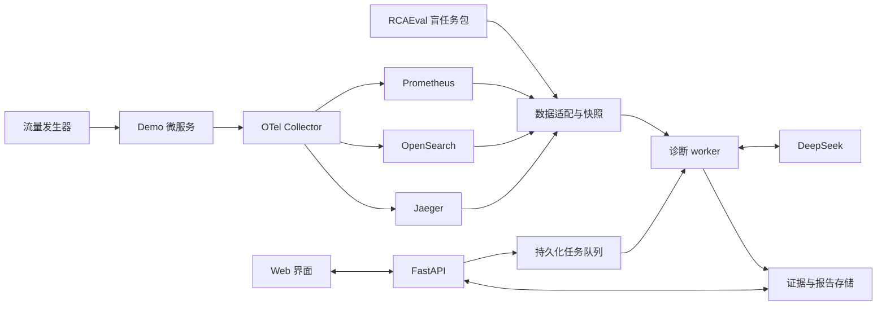

# GALA+ 微服务智能排障系统设计

日期：2026-11-09。版本：0.1，设计评审稿。本文确定首版边界与默认实现方案，不表示软件已经实现或完成现场验证。

2026-11-16 流程补充：本文保留为前期全局设计基线。用户已认可全局路线，各阶段实施以根目录 [AGENTS.md](../../../AGENTS.md) 的设计确认/交付审查流程和对应阶段方案为准；首阶段为 [M0 环境与接口验证](../../design/stages/m0-design.md)。M0 当前不实现或调用付费模型，模型接口验证纳入后续模型阶段。

## 1. 已确认的需求与设计决定

用户已明确：项目最终希望具备真实微服务环境接入能力；当前为学生和个人开发者，没有现成集群或遥测平台；首版选择 **OpenTelemetry Demo + RCAEval 回放**；开发语言首选 **Python**；前端由开发者决定；模型服务商暂定 **DeepSeek**。

当前机器先前只读检查：Windows，约 16 GB 内存，i7-14700HX；Python 3.11.9、Node 24.16.0、uv、Git 可用。当前命令环境未找到 Docker/WSL，不能据此断言系统完全未安装；虚拟化、Docker Linux 引擎与 WSL2 可用性需要实际检查。工作区目前只有论文及研读文档，尚不是 Git 仓库。

以下状态用词贯穿本文：**已确认**表示用户选择或有一手资料支撑的事实；**设计决定**表示本方案采用、可在评审时修改的工程选择；**待验证**表示有明确验证方法的假设；**待用户提供**表示无法由代码或文档推断的账户/预算信息。

首版交付：运行微服务实验环境、持续产生流量、读取三模态遥测、创建事故诊断任务、给出服务级根因候选和可复核证据、导出报告、执行盲回放评测。首先支持一个主要根因及备选候选。Docker 实例级结论只在证据支持时输出，不能称为 Pod 定位。

首版不覆盖生产自动变更执行、多租户公网服务、跨集群高可用、任意多故障联合定位及根因代码补丁生成。后续扩展以已有诊断质量和需求为依据。

## 2. 考虑过的路线

| 路线 | 收益 | 代价 | 决定 |
| --- | --- | --- | --- |
| OTel Demo 运行环境 + RCAEval 回放 | 同时检验实际接入与可重复实验 | 两种数据适配、需要容器运行条件 | 用户已选择 |
| RCAEval 算法优先 | 环境门槛低、易与基线比较 | 无法先证明在线采集和告警链路 | 保留为离线模式 |
| Kubernetes 优先 | 能直接验证 Pod 身份与集群告警 | 对当前资源和知识负担更大 | 后续阶段 |

应用内部选择显式状态机、关系数据库和图算法库。多智能体是多个受控分析角色，不要求多个独立服务或多个模型账户。首版暂不引入 LangGraph、AutoGen、向量数据库、Neo4j、Redis/Celery；当需要复杂分支恢复、历史知识检索或多机执行时再评估。

## 3. 技术选型

| 层 | 首版设计决定 | 原因与边界 |
| --- | --- | --- |
| 运行环境 | Docker Linux containers + Compose；Windows 采用可用的 WSL2 后端 | 与官方 Demo 部署路径一致；M0 验证 |
| 实验系统 | OpenTelemetry Demo **3.1.0**，带观测的 minimal 组合 | 固定提交 `dedc0178918e260823323b8d95005a8cb924b007`；镜像必须另外固定，不能只锁源码 |
| 采集 | Demo 已有 OTel SDK/插桩、Collector | 核对覆盖，缺失数据单独处理 |
| 指标 | Prometheus | 时间序列与区间查询；容器资源指标与应用指标分开 |
| 日志 | Demo 自带 OpenSearch | 避免首版替换现成日志管线；通过适配器隔离 |
| 链路 | Demo 固定版 Jaeger 2.19.0 | 查询 spans；及时归档事故快照，不能依赖内存存储长期保留 |
| 后端 | Python 3.11 系列、FastAPI、Pydantic 2、HTTPX | 类型校验、异步 I/O、结构化 API；具体兼容补丁版本在 M0 锁定 |
| 数值与图 | NumPy、pandas、scikit-learn、NetworkX | 指标预处理、BARO 适配、STRIX、允许环的有向图 |
| 任务编排 | 独立 Python worker + asyncio + 数据库任务状态 | 模型调用并发受控，Web 请求与长任务分离 |
| 持久化 | SQLite + SQLAlchemy 2 + Alembic；本地文件快照 | 单用户、单 worker 足够；保留迁移路径 |
| 前端 | React + TypeScript + Vite；Cytoscape.js 展示图 | 图查看、节点证据和任务状态为主；前端不处理模型凭证 |
| 模型 | DeepSeek 官方 API，提供者接口可替换 | 用户暂定 DeepSeek；具体模型见第 10 节 |
| 测试与检查 | pytest、pytest-asyncio、Ruff；前端 TypeScript 检查与关键 Playwright 流程 | 测算法边界、接入契约和端到端行为 |
| 依赖与交付 | uv/uv.lock；npm/package-lock.json；固定镜像版本与 digest 清单 | 可重复部署，不把 latest 当实验版本 |

SQLite 使用短事务、外键、busy timeout 和默认回滚日志，放在 Docker 本地命名卷。API 与 worker 可读写，但只允许一个 worker 领取诊断任务；不得把事务保持到网络调用结束，不在宿主映射/网络共享目录上并发写数据库。首版只运行一个活动诊断，其他排队；多 worker/多用户时迁移 PostgreSQL 和独立队列。

## 4. 可用资源与版本管理

| 资源 | 可以用于什么 | 不能据此假定什么 |
| --- | --- | --- |
| 本地 GALA+ 论文 | 四阶段架构、STRIX 公式、调查伪代码、实验口径 | 作者完整实现可获得或精确重现数值 |
| 作者公开仓库 | 基线、参考报告、样例、补充评测 | 核心智能体源码已开源 |
| OTel Demo 3.1.0 | 业务服务、流量、观测栈、故障开关 | 所有服务所有指标/日志/trace ID 都齐全 |
| RCAEval RE2-OB、RE2-TT | 各 90 个三模态故障案例 | 注入时间等同真实告警时间、标签天然隔离 |
| BARO 公开实现 | 固定版本指标排名基线 | 指标名已经证明故障类型，或 BARO 建立因果 DAG |
| DeepSeek API | 受控 JSON 分析和报告生成 | 已有 Key/余额、输出必然符合业务 schema |

最先取 RE2-OB 小样本核对格式，之后锁定完整 90 例清单；RE2-TT 作为后续独立验证集。下载前记录来源版本、文件大小与校验和，只获取当前阶段需要的数据。作者基线目录依赖较重，提取所需适配接口或在隔离环境运行，不整体导入项目环境。复用代码保留对应许可证及来源。

OTel 源码标签内仍存在 `DEMO_VERSION=latest` 等默认值。部署覆盖层明确设为 3.1.0，检查 `docker compose config` 的实际镜像，并在成功启动后记录 digest。minimal 使用基础、observability、extras 组合；普通裸 `docker compose up` 不代表完整观测环境已启动。具体锁定配置、镜像可下载性和 API 响应样本由 M0 产出。

## 5. 总体结构与部署



本项目与 Demo 分目录、分配置维护，以覆盖文件和共享 Docker 网络连接。后端默认只绑定本机 `127.0.0.1:18080`；Demo 入口沿用其配置，端口冲突时可配置。后端查询使用容器服务 DNS 和内部端口，用户点击观测页面使用单独的 public URL，避免混用 localhost。

部署形态为 Demo 原有服务，加 `gala-api` 和 `gala-worker` 两个进程/容器。前端构建后由 API 静态服务提供；开发时 Vite 单独运行并代理 `/api`。数据库、事故快照、模型调用元数据放在项目自己的命名卷中。导出通过 API 下载 ZIP/JSON/Markdown，数据库文件不交给前端。

Demo Collector 需要读取 Docker stats 的场景沿用其自身采集配置；GALA API/worker 不挂 Docker socket。故障操作由实验人员使用 Demo 控制界面完成；诊断 worker 不拥有故障开关、Docker 或集群变更接口。

## 6. 输入与数据契约

### 6.1 核心对象

所有对象有 `schema_version`；内部时间为 UTC 整数纳秒或精确整数转换，禁止浮点处理 span 时间，API 展示 RFC3339。单位在适配器中统一，延迟用毫秒，内存用 bytes，CPU 同时记录数值与百分比/核数语义。

| 对象 | 必需信息 |
| --- | --- |
| Environment | id、类型、后端连接配置引用、resource 映射版本、允许查询的服务范围 |
| EntityRef | environment_id、service_namespace、service_name、可选 instance_id/container_id/pod_uid；定位层级 |
| Incident | id、来源、告警时间、入口症状/服务（可空）、默认窗口策略、创建时间、去重键；实际 window/as_of 属于 run 和 snapshot |
| TelemetrySnapshot | id、incident_id、实际事件窗口与查询时间、实体清单、原始数据文件、归一化文件、数据质量、内容 hash |
| MetricSeries | 实体、指标名/类型/单位、labels、样本、采样步长、缺口、来源查询 |
| LogRecord | 实体、event_time、observed_time（可空）、severity、body、trace_id/span_id（可空）、原始定位 |
| SpanRecord | trace_id、span_id、parent_span_id、kind、实体、开始/结束、status、允许的 attributes |
| Evidence | 服务端生成 id、类型、实体、观测窗口、source locator、原文/数值快照、转换版本、父证据 id |
| Candidate | 实体、各模态排名、故障假设（可 unknown）、来源、证据 id、模型分数（不称概率） |
| Assessment | 候选、支持/反证 id、结构化解释、缺失项、分析状态、停止原因、模型配置 |
| Report | 排名、诊断状态、摘要、推断传播路径、引用、三类建议、限制、运行时/用量、版本信息 |

实体主键为 `(environment_id, service_namespace, service_name)`。实例身份使用明确 resource 信息；缺少 namespace 时使用环境默认值并记录。容器名到服务名采用部署清单/Compose labels 与验证后的映射，不靠截取字符串猜测。实例与服务映射带有效时间。Kubernetes 后续使用 pod UID 并区分同 Pod 的容器。服务级 trace 证据不能复制到每个副本并冒充实例证据。

### 6.2 在线查询适配器

定义统一接口：`probe_capabilities()`、`list_entities()`、`fetch_metrics()`、`fetch_logs()`、`fetch_traces()`。每次返回数据及 `coverage/quality`，支持截止时间和分页预算，返回规范对象；诊断算法不依赖供应商返回 JSON 的具体形状。

| 来源 | 已核实入口 | M0 必须取得的契约样本 |
| --- | --- | --- |
| Prometheus | `/api/v1/query`、`/api/v1/query_range` | 实际指标名、labels、单位、CPU/RSS/请求量/错误/延迟覆盖 |
| OpenSearch | `otel-logs-*` 的 `_mapping`、`_search` | 时间字段、service 字段、正文、severity、traceId 的存在率和映射类型 |
| Jaeger | 固定版稳定 v3 Query API 或 QueryService | 查服务、按窗口查 trace、按 id 取完整 trace、OTLP JSON 结构与分页/上限语义 |

Jaeger HTTP 的代理/base path 不写死进算法。M0 验证 v3 路由；必要时使用同版本 gRPC QueryService。若该固定部署只能通过旧内部 API 提供某功能，只能放入 `jaeger_2_19_compat` 适配器并明确版本限制，不能宣称它是通用接口。

Demo Collector 配置了 `docker_stats`，但必须现场验证每个容器的 CPU/内存是否可采及其标签映射；host metrics 是宿主/VM 级，不能当各服务资源指标。请求率、错误率和延迟只在相关指标可用时查询。先读取时序类型，counter 使用 rate 并处理重置，histogram 用正确 bucket/单位求分位数；已经是速率或分位值的指标不得再次 rate。

日志首选 `@timestamp` 事件时间并保留 `observedTimestamp`；具体字段映射经 M0 确认。traceId 存在时可精确关联，无 ID 时只称同服务/时间窗内的相关线索。Demo 存在不输出日志的组件，`unsupported` 与查询失败、确实无日志分开。

每个后端查询初始超时 10 秒、瞬态错误最多重试 1 次、并发最多 2；单快照上限：200 条允许的指标系列、20,000 spans、2,000 logs、50 MiB 原始返回量。达到限制须记录截断与选择规则，不能静默当作全量。分页按稳定时间+唯一键游标；后端无法稳定分页时记录该限制。

正常段与异常段分别查询/限额，spans 和 logs 各预留至少 60% 额度给异常段；区间内按服务轮转、稳定时间及源 id 选样，保留首次错误/极端延迟及代表性正常条目，并记录选择偏差。指标先按冻结 allowlist/实体 key 选系列，再为每条保留正常与异常桶，不能只保留按升序返回的前 N 条而丢掉故障数据。质量记录细化到服务、模态和时段。

### 6.3 时间窗与快照

默认事故时间 τ 为规则最终 firing 时间。事件查询窗 `[τ−10min, as_of]`，正常基线默认 `[τ−10min, τ−2min)`，异常区间 `[τ, as_of]`，中间 2 分钟为 guard band。只用完整 10 秒桶计算异常指标：`min_cutoff = ceil_to_10s(τ) + 30s`，确保至少 3 桶。默认 `as_of = min(τ+5min, max(任务创建时间−15s, min_cutoff))`，`ready_at = max(任务创建时间, as_of+15s)`。这将新告警安排在数据可见后采集，并将旧事故的异常尾窗限制在 5 分钟内。

入队时固定这些时间，在 queued 状态等待 ready_at；尚未到达的截止时间只是预约采集目标，不提前读取未来数据。实际采集及诊断的 300 秒 deadline 从 worker 在 ready_at 之后成功领取时开始。排队、重启不自动移动 as_of。手工历史诊断可指定 as_of，必须在 `[min_cutoff, τ+30min]` 内且不晚于当前可见截止；无足够时段的数据标记不足。离线按数据集的事件时钟使用相同窗口策略，不使用导入当天的墙钟。相邻观测延迟及 guard band 均为初始值，M0/M1 校验。

离线默认的模拟任务创建时间固定为 τ：known_onset 中 τ 为已知注入时间，alert_replay 中 τ 为最终 firing tick。因此首轮 as_of 固定为该 τ 的 min_cutoff，不能由执行评测的当天或运行速度决定。基准若比较更长观察窗，需另建 `observation_horizon` 协议并让所有方法使用相同截止。录像不足以覆盖固定窗口时保留缺测/失败并进入原分母，不临时移动截止。实际模型用时使用执行墙钟另计，不改变模拟数据时间。

快照内所有查询使用同一 as_of。只有事件时间不晚于 as_of 的观测可参与；有 ingestion/observed 时间时也按截止时间过滤。结束时间晚于 as_of 的 span 不作为完整时长，记录未完成/被截断状态。缺少入库时间的数据仅声明 event-time 回放，不能声称重现当时可见性。

指标对齐初始步长 10 秒，使用过去的桶内样本聚合；不虚构 1 秒采集精度，不将缺失填成零，不使用跨越截止时间的插值。保留原始采样频率，算法比较使用同一策略。再次获取晚到数据产生新 snapshot/run，不覆盖旧结果。

Jaeger 默认内存存储有逐出和重启丢失风险，Prometheus/OpenSearch 的默认部署也不构成项目快照保留承诺。每次诊断先保存快照，再开始推理；之后报告引用项目归档，即使外部数据过期仍能复核。

### 6.4 离线适配与标签隔离

RCAEval 原始数据由导入器在评测侧读取，转换为随机事故 id 的盲任务包；所有服务身份仍保留真实名称，去掉透露注入服务/故障的目录、文件名、flag、注入控制日志和答案列。盲包目录与 labels/reference reports 分离，worker 仅能读取盲包。

支持两个明确标记的评估协议：`known_onset` 用注入时间作为已知事件起点，便于与论文比较；`alert_replay` 按预先固定的入口 SLI 和因果时间规则触发，验证线上等价流程。两者分开报告。先实现 known_onset 与标签隔离，再实现 alert_replay，不把前者结果包装成实时告警效果。

输出服务级 AC@k，只有标签确实包含实例/Pod 且数据支持匹配时才另外统计相应层级。模型看不到注入说明、参考报告或真实标签。健康窗口单独加入，检查系统是否会无依据地总是猜测根因。

## 7. 诊断算法与论文对应关系

总体保持“指标/链路粗排 → 融合 → 证据包 → 图约束调查 → 综合与建议”。所有排名、提示词与边界规则记录版本。现阶段目标是可检验的独立重实现，不使用“与作者原始系统等价”的表述。

### 7.1 指标排名

实现 `MetricRanker`：固定版本公开 BARO 适配器输出指标排名，并映射至所属服务，某服务多个指标保留最高名次和所有相关证据。故障类型仅为假设，例如 CPU 指标异常不能证明 CPU hog 注入或具体代码原因。

公开 `baro()` 的核心是正常段拟合 RobustScaler，异常段最大变换值排序；它不建立指标因果 DAG。原始基线作为对照；线上适配前先执行单位、counter/rate、标签、时间窗和质量校验。仅选择明确“升高代表异常”的首版指标 allowlist：CPU 使用、内存使用、错误率、延迟；吞吐下降只作为辅助证据，避免误用 signed max。

正常段至少 20 个有效样本且窗口覆盖率至少 80%，异常段至少 3 个有效样本。零/近零 IQR 不直接作除数：保留公开基线的原始结果用于基线协议；工程路径将该系列标为 `constant_baseline`，按预配置绝对阈值判异常或只展示原值，不编造可比较 z-score。阈值由指标单位和健康运行测量得到。绝对阈值命中形成独立候选桶，排在普通稳健评分桶之前，同桶按告警严重度、持续异常桶数、实体 key 排序；不同单位的超阈值量不与 z-score 混排。该候选选择属于工程版本，与原始 BARO 对照分开。无合格系列和阈值候选则指标粗排 unavailable，不能默认排序为健康。

论文式按秒数据与实验环境不同采样精度分别记录。任意工程预处理与官方基线的差异都在评估配置中列明，配对比较使用相同可见窗口。

### 7.2 调用图与 STRIX

按 `(trace_id, span_id)` 去重，父子匹配必须在同一 trace 内。跨服务父子关系形成 caller → callee 边；同一次 RPC 的 CLIENT/SERVER 两端只算一次调用，时长优先使用 callee SERVER span。没有 SERVER 时可保留边及客户端观测，单独标记计时口径，不混入服务处理时长分布。异步 links 另存为关联证据，首版不作为同步调用边参与 STRIX。

图允许环。缺失 parent、未知服务、截断 trace 产生质量指标，不补造边。每个节点及边保存调用数、均值、P50/P95/P99、累计时长及可追溯 span 引用。

用于探索的拓扑可汇集整个观测窗口的边；STRIX 延迟和调用量统计只用异常区间内完整 SERVER spans，基线统计单独保存用于证据对照。Impact 的最慢下游均值按该 caller→callee 边上的服务端样本计算。仅有 CLIENT span 时，只有明确、经适配规则验证的对端实体映射才保留观测边；未知目标保存为未解析外部依赖，不编造 callee。下游未知/样本缺失的节点不是已知叶子，其 Impact 设为 unavailable。

STRIX 的工程口径固定如下：

- Instability：合格入站 SERVER span 延迟的 P99/P50，分位采用线性插值。默认至少 100 spans 且 P50 高于时钟分辨率；否则该维度不可用。
- Centrality：在整个快照窗口已观测拓扑上运行 NetworkX PageRank，alpha=0.85，初版不按调用量加权，乘 `(1+入度)/(1+出度)`；超时/不收敛时该维度 unavailable。
- Impact：`累计时长 × max(0, 1 − 最慢直接下游平均时长 / 自身平均时长)`，下游集合为异常期观测边。自身均值为零/缺失，或下游目标未解析/仅有客户端计时/服务端样本缺失时不可用。只有调用插桩能力已确认、参与统计的 traces 完整、没有未解析目标且没有下游调用的 observed_leaf，才取下游均值为零。它是延迟启发式，不称精确独占时间。
- 三个有效维度各自降序排序，用 `Σ 1/(60+rank)` 融合。相同分数并列同名次；全体相等的维度不贡献排序。硬 Top-K 边界遇到并列时仅以实体 key 稳定选入并记录被截断的并列候选，不修改原分数/名次。记录每个候选有效维度数；缺项不补造数据。

### 7.3 跨模态融合与诊断包

融合输入是最多 12 个候选的并集：指标前 6 + STRIX 前 6。Consolidation 角色读取各自排名、数据覆盖、异常摘要与来源，返回统一排名和故障假设，不能创建输入集以外的实体。非法输出重试一次后，以两个模态排名等权 RRF 确定性降级，并标记 model_fallback。跨模态 RRF 是降级设计，与 STRIX 内部三维融合区分。

诊断包按需生成，包含当前实体的指标摘要/有界时序、带属性一跳邻域、错误及异常日志、适量普通日志、代表性 spans、缺失/截断信息。日志按归一化消息去重，但保留次数和首末时间；相同模板的不同错误码/实例不得错误合并。截断优先保留异常时间附近、首现、最严重及代表性普通条目，规则固定。所有数值摘要由程序计算，不委托模型计算分位数。

证据使用 `sha256(schema_version + snapshot_id + canonical_locator + transform_version + payload_digest)` 生成 id；源 locator 排序序列化，不包含提示构造顺序。派生证据记录父 id。模型只能引用当前快照登记的 id；引用必须同时匹配实体与时间语义。

### 7.4 图约束调查

默认 Top-K=6、邻居 batch=2、仅种子一跳；前驱和后继都可访问。邻居先按实体 key 排序，再按固定 run seed 随机无放回抽样，保留随机探索同时能够重复。多个种子共享邻居的诊断包可缓存；调查结果仅在 `snapshot + entity + bundle_hash + candidate_context_hash + model/prompt_version` 一致时复用，保留每条分支对结果的引用。

全案最多调查 14 个不同实体；分支轮转分配剩余邻居名额，避免先完成的分支耗尽资源。每次评估返回支持/反证、故障假设、缺失项、模型根因分数。为减少无依据的提前停止，只有分数 ≥0.6 且符合第 8 节 supported 规则时停止该分支；这比论文的纯置信度停止多了工程证据门槛，评测单独注明。预算/邻域耗尽同样终止，保留原因。

不会因查看邻居的诊断包而继续递归调查二跳实体。图中显示某节点不表示该节点已经调查。对同一快照随机策略可复现，模型响应仍可能有变化，须通过重复运行统计。

### 7.5 证据综合与建议

Evidence Synthesis 角色综合初排、各实体调查与反证，返回最终候选排序、候选故障机制、传播假设及证据引用。程序检验每个传播跳是否存在观测边/允许反向影响关系；调用方向与故障影响方向分字段，禁止把图连通性当成因果证明。

最终候选白名单为初排候选并集及实际调查过的一跳实体，允许新发现邻居晋升第一；仅在图上显示但未调查/未入初排的实体不能晋升。无指标/STRIX 种子时，首版只整理日志并输出 insufficient_evidence，不偷偷增加日志种子算法。纯拓扑排名可展示为调查线索，但没有合格异常的实体不作为最终诊断排名返回。

Remediation 角色生成即时缓解、永久修复、预防三类建议。每条含目标实体、作用机制、依据、前置检查、预期验证指标、可能影响及适用条件。未知部署资源/配置不能输出凭空给定的扩容数字或可直接执行的变更承诺。首版建议以文本为主，不连接执行器。

最终经 schema、实体、引用、数值与路径校验。可核验的数值优先由模板插入；未被证据支持的陈述标为假设或删去。模型解释不作为新的原始证据，不能通过反复引用自己增加可信度。

## 8. 诊断状态与失败行为

任务运行状态和诊断结论状态分别记录。诊断状态：

| 状态 | 判定 |
| --- | --- |
| supported | 至少有一个直接局部异常的有效证据，另有独立来源支持，并且没有尚未处理的关键反证；仍然是有证据支持的假设，不代表真值 |
| provisional | 有可用异常证据/候选，但独立性、覆盖或解释不充分 |
| insufficient_evidence | 关键数据不可用、直接反证排除全部合格候选、只有拓扑中心性，或没有可支持的异常 |

独立性按数据血缘判定：trace 衍生 RED 指标与相同 trace 不算独立模态；同一日志的摘要与原文也不是两份独立证据。局部资源异常 + trace 变化、原始应用计数器 + 独立错误日志可形成不同来源支持。模型不能自行把质量门槛改为满足。

程序预先为证据生成异常标记（冻结规则的 metric_threshold/robust_shift、与健康段相比新增/明显升高的 error_log 或 server_error）和 lineage_group。supported 要求本实体有效局部异常、第二独立 lineage_group 的支持、全部引用合法且没有未解决 conflict_code。首版关键冲突规则包括：模型声称资源饱和但完整资源观测未达到冻结阈值；声称已证实跨服务传播但缺少相应观测关系；把来源身份冲突/严重截断情况下的推测标为确定；已有直接反证被丢弃。任一无法自动确定的因果争议保守降为 provisional。模型声明“无反证”不能绕过程序检查。

有合格局部异常但独立支持不足、因果争议未解时归 provisional；直接反证排除全部候选时才拒判。partial 中可以展示纯拓扑粗排为调查线索，但这不属于最终诊断排名，不计入 AC@k/MRR 命中。

| 情况 | 行为 |
| --- | --- |
| 日志为空且采集正常 | measured_empty，允许静默资源故障假设 |
| 日志未支持或查询失败 | unsupported/fetch_error，不说“没有错误日志” |
| trace 缺失 | 指标/日志降级，不能输出已证实的传播链 |
| 指标缺失 | trace/日志降级，不能声明某资源使用正常 |
| 全部来源不可用 | 不调用 LLM，任务 failed，给接入诊断 |
| 采集有数据但异常证据不足 | 完成任务，结论 insufficient_evidence |
| 模型不可用/预算耗尽 | 返回已有确定性候选与证据，任务 partial，说明哪些阶段未执行 |
| 非法 JSON/实体/证据 | 限额内修复重试一次；仍失败则阶段降级，不展示未经校验的诊断 |
| 用户取消 | 停止派发新查询/模型请求，尽力取消在途请求，保留已有结果及实际消耗 |

## 9. 持久化任务、API 与界面

### 9.1 数据表及执行语义

主要表：environments、incidents、snapshots、runs、stage_results、assessments、evidence_index、reports、run_events、llm_calls、alert_states、feedback、schema_migrations。大体积原始和标准化数据放文件，数据库保存相对路径、大小、hash；禁止浏览器指定任意宿主绝对路径。报告与证据快照不可变，修订生成新 run/report。

运行状态：`queued → collecting → ranking → investigating → synthesizing → completed`，可进入 `partial/failed/cancelled/interrupted`。API 先事务提交 incident/run 后返回 202；模型/源暂不可用仍可接单并返回降级，只有无法可靠保存队列才拒绝。worker 用短事务原子领取 ready_at 已到的 queued 并持有 lease，5 秒心跳，30 秒过期；重启将失联运行标记 interrupted。首版不自动重发不确定是否已计费的 LLM 请求。

retry 创建新 run，固定复用原 as_of/已验证快照及兼容阶段缓存，保留父 run；原任务尚未生成快照时仍沿用原截止重新查询，标明这是新的采集尝试。refresh 创建新的 as_of/快照/run，不修改旧结果。领取时生成递增 fencing_token，所有阶段提交和最终发布必须条件匹配当前 owner/token/活动状态；旧 worker 的迟到响应只能补记原请求用量。取消与完成按数据库事务先成功者确定终态，已完成任务的 cancel 返回现状。快照先写临时文件、校验、原子 rename，再提交数据库索引；未被索引的孤立临时文件不暴露给报告。

续租和提交条件还必须满足数据库时钟下 `lease_expires_at > now`，过期 worker 无权复活 lease。队列轮询时持续回收过期活动 run 为 interrupted，不只在进程重启时清扫；恢复依靠显式 retry。文件存放在 run/attempt 唯一且不可覆盖的路径，rename 本身不构成对用户发布，只有通过 fencing 条件的数据库索引事务成功后才可见。失效进程写出的孤立文件以后受控清理，不能覆盖任何有效快照。

事件表按单调 sequence 记录阶段、实体开始/结束、停止原因和用量。前端默认 2 秒增量轮询，不依赖 WebSocket；刷新页面从持久状态恢复。FastAPI BackgroundTasks 不承担可靠诊断队列职责。

| API | 行为 |
| --- | --- |
| `GET /api/v1/health/live`、`.../ready` | 进程存活、数据库/worker就绪；后端源不可用作为详细状态，不让存活探针反复重启 |
| `GET /api/v1/environments`、`.../{id}/capabilities` | 脱敏环境配置、三模态能力、最近探测结果 |
| `POST /api/v1/incidents` | 指定环境、告警时间、症状、可选入口服务/历史 as_of、数据模式；创建首个 run，返回 202/id/实际窗口/ready_at |
| `POST /api/v1/webhooks/alertmanager` | 校验 token，接受 firing，按 fingerprint + startsAt 去重；resolved 更新事故状态，不等于诊断已解决 |
| `GET /api/v1/incidents`、`.../{id}` | 游标分页列表、事故详情和 runs |
| `GET /api/v1/runs/{id}`、`.../events?after=N` | 运行状态、预算、增量进度 |
| `POST /api/v1/runs/{id}/cancel`、`.../retry` | 幂等取消；显式新运行重试 |
| `POST /api/v1/incidents/{id}/refresh` | 创建有新截止时间的新采集与诊断，不覆盖旧报告；可见截止尚未推进或已达该事故窗口上限返回 409，并给可重试时刻/需创建新事故说明 |
| `GET /api/v1/runs/{id}/report`、`.../graph` | 可验证报告、观测图及调查状态；结果未就绪返回明确状态 |
| `GET /api/v1/evidence/{id}` | 读取归档证据，返回来源与脱敏内容 |
| `GET /api/v1/runs/{id}/export?format=json\|markdown\|zip` | 导出报告/脱敏证据，不包含凭证、标签或私有模型推理内容 |
| `POST /api/v1/runs/{id}/feedback` | 人工标注正确/错误/不足和备注；不自动当成真值训练模型 |

创建接口支持 Idempotency-Key，同一 key+请求体返回原任务，不同体冲突返回 409。输入/校验错误 422，未授权 401，资源不存在 404。后端临时不可用返回 503 及可重试信息。错误包含 request_id，不返回密钥或原始堆栈。导入和基准批处理先通过受控 CLI，不做任意文件上传页面。

本地单用户首版不设账号体系，业务 API 只接受 loopback 同源访问、禁任意 CORS，修改操作校验 Origin；webhook 使用独立静态 token 并绑定唯一 Environment，不能由负载任意选择环境。配置来自本地受控文件，界面只读展示。若开启远端访问必须先补认证，不能仅修改监听地址。

### 9.2 首版界面范围

1. 事故列表：状态、环境、首次告警、候选根因/证据不足、耗时、成本记录状态。
2. 创建诊断：选择已配置环境、时间窗、症状/入口；不要求用户输入真实根因。
3. 事故详情：顶部结论与数据覆盖；阶段进度；Top-3 及支持/反证；观测依赖图；按时间排列的证据；三类建议；限制与反馈。
4. 数据源状态页：显示连通性、覆盖和最近错误，凭证只显示已配置/未配置。
5. 回放结果页：读取批量评测产物，展示协议、版本、指标、失败与拒判案例。

图中节点区分告警对象、被调查对象、根因候选及数据缺失；边默认表示调用方向，推断影响路径单独开关。点击节点定位证据，原始 trace/log 外链仅作辅助。用户不需要阅读内部 prompt 或工具调用栈才能理解结论。首版以中文界面/报告为主，服务名与原始日志保留原文。

## 10. DeepSeek 接入、运行预算与可替换性

2026-11-09 核查官方文档：模型标识使用 `deepseek-flash`、`deepseek-v4-pro`，不照搬论文中的旧型号。**初始设计选 `deepseek-flash`**，显式非 thinking 模式、temperature=0、非流式 JSON 输出；每个角色共用 provider，后续按同样盲测比较模型。此为设计默认，尚未做 Key/配额/效果验证。[官方入口](https://api-docs.deepseek.com/)

`LLMProvider.generate_json(messages, schema, limits)` 返回解析内容、供应商返回的模型标识、usage、finish_reason、request_id/耗时。使用 HTTPX 调用官方 Chat Completions 端点，供应商特性集中在 adapter。模型、base URL、thinking 模式、温度、prompt hash、schema 版本都进入 run manifest；别名可能换底层模型，若 API 不暴露精确版本则注明无法锁底层权重。

启用 JSON Output 并在提示中提供 JSON schema/示例，随后 Pydantic 严格校验；JSON 合法不等于 schema 合法。处理纯空白、截断、额外字段、未知实体与引用。只把修复所需的错误和原始允许上下文交给一次修复请求，不无限追加对话。[JSON 输出说明](https://api-docs.deepseek.com/guides/json_mode/)

初始预算（工程默认，M0/M3 实测调整后版本化）：

| 配置 | 初值 |
| --- | ---: |
| 同时活动事故 | 1 |
| LLM 并发 | 3 |
| 种子/不同调查实体上限 | 6 / 14 |
| 全案物理模型请求上限，含重试 | 18 |
| 单案输入/输出 token 预算 | 80,000 / 18,000 |
| 单次模型输入/输出上限 | 6,000 / 1,024 tokens |
| 单次网络总截止/全案截止 | 45 秒 / 300 秒 |
| 每实体/阶段结果修复次数 | 最多 1，受全案预算约束 |
| 原始模型内容保存 | 默认仅保存校验后的业务 JSON 和用量，不保存隐式推理字段 |

融合、综合和建议共预留 3 个请求及相应 token；调查开始前原子预留预算。并发预算包括正在执行的请求，不能等响应后才检查。18 次不是目标用量；缓存、早停、缺证据拒判均应减少调用。输入无法精确计 token 时用保守估算与模型最大输出预留，响应后按 usage 对账。账本中的估算与实计分开。

全案 deadline 从可采集任务被领取时起算，包含采集和所有诊断阶段；调查不得进入最后 90 秒，预留综合与建议各最多 45 秒。核心阶段首次调用优先于邻居扩展和任何修复/网络重试；即使剩余 token 足够，时间不足也返回 partial。每个物理请求在发送前以事务记录 request_attempt 和预算预占，失败、取消、崩溃均不自动释放可能已消耗的额度；已知 usage 对账，其余保守计账。retry 的新 run 仍受同一日/批次总预算约束，不能通过重建任务绕过限额。

网络错误/429/5xx 在限额与截止内退避重试；400/401 等配置错误不盲重试。模型网络超时可能已计费，记录 unknown_usage 并保守计入额度。厂商价格单独配置日期及输入/缓存/输出单价；缺少价格时不显示伪造金额，也不启用按金额限额的付费批次。**测试总金额上限、日预算和 API Key 待用户在本地配置**；默认未启用付费调用时，支持 mock 合约测试与无 LLM 基线模式，明确标记其结果。

密钥由 worker 环境或本地忽略文件注入；前端、快照、仓库、日志不含密钥。base URL 只接受管理员配置，不由事故文本或模型指定。数据在出站前做字段 allowlist、凭证/个人标识脱敏和大小截断；保留 evidence id 与稳定 service id 以便核验。日志中的命令或提示属于数据，不获得执行权限。

## 11. 告警与实验闭环

首个连通性里程碑允许手动创建事故，首版最终验收还必须包含自动告警创建事故。Demo 未经核实不能假设自带符合需求的 Alertmanager；项目增加轻量 `alert_poller` 子命令，读取 Prometheus 固定规则并调用同一事故创建服务。Alertmanager webhook 保留为真实环境接入路径。

初始规则每 30 秒评估一次，观察最近 60 秒；使用明确的入口/目标服务集合和服务端 span 口径。请求数 ≥20 且错误率 >5%，连续 2 次成立触发；请求数 ≥20 且 P95 >1,000ms，连续 2 次成立触发延迟告警。默认入口 frontend，付款场景另监测 checkout/payment 的错误率；规则配置在故障实验前冻结，不根据答案挑服务。span 衍生指标的名称、span kind、错误 status 和时间单位须 M0 核实；没有合格序列则规则 unavailable，不能触发“正常”。

首次命中时间和最终 firing 时间分别记录，以最终 firing 作为 τ；持续异常沿用事故 id，连续 3 次恢复后标记 resolved。相同 `(environment, rule, service)` 在未恢复前不重复创建诊断；新诊断由用户重跑或新一次故障触发。恢复只表示监控条件不再满足，不表示模型建议已执行。离线 alert_replay 按相同规则从过去向未来推进。

线上与回放共享同一确定性规则状态机，以 UTC 30 秒 tick 为单位。alert_states 持久化 last_tick、命中/恢复连续计数、firing 状态及 active_incident_id；重复 tick 幂等。缺测/规则 unavailable 中断连续计数，但已 firing 的告警不能被当成恢复。转 firing、更新状态和创建 incident/run 在一个事务中完成，重启后继续最近状态。首版 webhook 只验标准 Alertmanager firing/resolved 契约及环境绑定；M2 真实自动触发验收使用 poller，不要求额外部署 Alertmanager。

若当前 tick 与 last_tick 相隔超过 30 秒，先重置命中/恢复计数并保留已 firing 状态，再评估当前 tick；线上不补造遗漏时段的历史告警。连续回放通常无 tick 空洞；模拟停机时使用相同规则，不能把相隔多分钟的两次命中计为连续。

固定版故障实验至少包括：

| 场景 | 真值与目的 | 需要的流量/证据 |
| --- | --- | --- |
| 健康流量 | 无注入故障，检查是否无依据强行定位 | 基线请求、正常错误率、正常资源变化 |
| `paymentFailure` | Payment 故障，验证错误链和日志 | 实际 checkout 请求，Payment 错误 spans/日志 |
| `adHighCpu` | Ad 服务 CPU 异常，验证资源证据 | 首页流量、正确容器映射及 CPU 指标；可手工创建诊断 |
| `paymentUnreachable` | 故障设置在 Checkout 的错误目标地址，不把 Payment 无响应自动判成 Payment 内部故障 | Checkout 错误、缺少 Payment SERVER span 的解释和数据质量 |

每个场景先正常运行至少 10 分钟，再按预设时长开启故障，采集诊断，关闭并确认恢复。第一轮人工通过官方故障 UI 操作，保存切换时刻、参数和真值到评测目录。故障控制面及其显式标记不作为诊断输入；联通演示和盲测分别标记。后续自动化注入须独立进程、保存完整配置并验证恢复，不交给诊断模型执行。

## 12. 测试、评测与验收

### 12.1 必须通过的工程检查

- 算法 fixtures：环状图、缺失父 span、双端 RPC 去重、低样本 P99、零延迟、叶节点、PageRank 失败、指标缺口/重置、近零 IQR、日志去重保留时间、同名服务/多实例。
- 接口契约：固定版 Prometheus/OpenSearch/Jaeger 的成功、空结果、分页/截断、400/404/429/5xx 与超时。识别 Jaeger v3 的合法空结果，不把坏路径 404 当无 trace。
- 模型契约：正常 JSON、空白、截断、未知实体、伪造引用、错误类型、慢响应、重试和预算账本。全部报告引用必须 100% 可在快照解析，非法引用不能进入通过校验的报告。
- 可靠性：API/worker 重启、失联 lease、同一请求重复提交、取消、重试不覆盖历史、预算耗尽、多个诊断排队；不把已接受任务静默丢失。
- 隔离性：改变标签/目录/注入说明不能改变盲输入；追加未来数据不能改变旧 snapshot/hash/确定性排名；改动后端保留数据不能改变归档证据。
- 关键 UI 流程：创建事故→查看进度→定位证据→导出报告→重开仍可复核；缺失数据和失败状态可见。

### 12.2 评测设计

同一盲清单、同一窗口、同一实体粒度，比较：BARO 指标基线、STRIX、确定性双排名融合、完整 LLM 调查。额外记录去掉图调查的消融，判断额外调用是否有收益。

先用 RE2-OB 按故障实例重复编号分组：1 号重复用于开发校准，2–3 号作为冻结评估集；具体清单以实际数据校验后锁定。它检验同域重复事故，不能称跨故障泛化。RE2-TT 在参数冻结后单列跨系统评估；更复杂故障以后再引入 AegisLab。

指标包括服务级 AC@1/AC@3/MRR、初排 Recall@6、拒判率、故障类型正确率（标签支持时）、证据可解析/可核验率、运行失败率、模型调用量、耗时与成本。AC@k/MRR 主分母包含所有合格有标签的输入：没有有效排名的超时/拒判作未命中；alert_replay 未触发另计端到端未命中，同时给出告警覆盖率和已触发条件下的诊断准确率，避免过滤困难案例。

计分细则：partial/provisional 只要有通过校验、可展示的最终排名，就按实际名次计分，并单列此类比例；insufficient_evidence、没有有效排名的失败/超时属于拒判，计零。supported-only 仅作附加子集，不替代全体分母。known_onset 的基线与完整流程使用同一截止；alert_replay 任何方法都不能借用注入时刻做自己的拟合切分。

回放事件归属由隔离的评分器判断：每个系统预先固定 SLI 规则清单；单故障案例只将注入时刻至注入后 5 分钟内第一次新 firing 关联该案例，其后同次故障触发去重。注入前 firing 计误报，不能充作成功检测；没有恢复而跨越注入的旧 firing 不算新检测。无可计算 SLI、无新触发保留在端到端分母并记覆盖失败。基于真值的 5 分钟关联只用于评分器，不给诊断 worker。

有证据支持仅是质量门槛，不是模型正确率。人工至少检查每类代表样本的论据与反证。SURE-Score 的四个维度作为人工报告检查表；缺少原始完整评分清单/相同评委时称“参考 SURE 维度”，不宣称复现原 SURE 分数。健康窗口单列误报，至少 5 个不重叠窗口。

LLM 多次运行最终应报告至少 3 次的结果分布；付费预算不足可先 1 次冒烟，但不得标作完整统计结论。时间/token 上限属于可执行限额，准确率数值不预先虚构。首版必须给出完整可复核结果和与基线的差异；如果整体未优于基线，结论就是效果尚未达标，不能靠更换分母隐去。

M3 必交矩阵明确为：RE2-OB 冻结评估的 2–3 号重复（预期 60 例，按实际清单核准）在 known_onset 下运行 BARO、STRIX、双排名 RRF 各一次；完整 LLM 流程及去图调查消融各 3 次。去图调查消融保留相同候选融合、综合与建议，但不运行 Investigator，综合只看初排与候选证据包。Demo 的上述 3 类故障各做 3 次正常→故障→恢复实验，其中 Payment 自动告警为硬性验收，Ad 允许手工触发并另报告警覆盖；5 个独立健康窗口既运行告警检测，也显式运行诊断以测强行定位。alert_replay 在同一 RE2-OB 冻结集执行并报告可用性/检测覆盖；模型只对真正触发的新事故运行 3 次，未触发保留分母。TT 与 AegisLab 属 M4 扩展，不阻挡首版工程验收。预算不足的矩阵单元标为未完成，不以少量冒烟替代完整实验。

这里“真正触发”仅指盲告警状态机实际产生 firing，包含随后被评分器判为误报的事件；队列不接受评分器按真值筛选。alert_replay 对同一份盲触发事件也运行三个确定性基线各一次、完整流程及去图调查消融各三次，所有方法共享告警和快照。三次实验使用显式 repetition_id 及固定 seed 列表 `[11,23,37]`；原始数据/确定性特征可复用，模型响应、调查结果和 LLM 阶段缓存不得跨 repetition_id 复用。用户日常 retry 可以复用兼容结果，但不能把这种重试计作独立实验。

### 12.3 分阶段完成条件

| 阶段 | 可审查交付 | 完成条件 |
| --- | --- | --- |
| M0 环境与接口验证 | 固定版本 manifest、启动说明、三模态真实响应样本、资源占用记录、DeepSeek 无敏感数据契约探针 | minimal 连续运行 30 分钟；已知调用边可查询；Payment 日志及 Ad 容器资源归属可验证；模型 JSON 调用单独标记通过/未配置 |
| M1 数据与可重复基线 | 统一 schema、在线/离线适配、不可变快照、BARO/STRIX、命令行 JSON 报告 | fixtures 与契约测试通过；同快照确定性算法重复一致；盲标签隔离；至少一个真实事故快照可重放 |
| M2 任务与界面闭环 | API/worker/队列、告警轮询、Web 证据图、状态和导出 | 真实告警可创建事故；重启/取消/失败行为符合契约；端到端 UI 流程通过 |
| M3 智能体诊断 | DeepSeek 四角色、图调查、预算/引用检查、分层建议 | Payment、Ad、不可达三个场景与健康对照有归档结果；完成配对基线/完整流程比较；明确正确与错误案例 |
| M4 真实环境准备 | 可替换适配器契约、部署/运维文档、K8s 身份方案 | 另一个数据源或应用接入验证通过；真实生产验证另列，不借 Demo 结果替代 |

第一版发布范围为 M0–M3。M4 是扩展方向。M0 数据覆盖不达标时先修采集和映射，不能只调 prompt 掩盖问题。

## 13. 资源、运维与扩展边界

官方 minimal 估计约 3 GB 应用内存、约 14 GB 磁盘，不包含所有宿主和开发开销。16 GB 主机先以受控低流量运行，初始容器总预算目标 6–8 GB，实际测 RSS、CPU、磁盘增长、响应延迟和 OOM；这是容量验证目标，不是已测保证。

故障/健康场景顺序执行，不同时全量跑 TT 评测和在线负载。默认项目归档软期限 30 天、容量上限 5 GiB；到期提示，首版不自动删除可引用证据，容量满时停止新归档并明确报错，等待导出或受控清理。自有数据卷与 Demo 数据卷分离；关闭容器不自动清掉项目快照。

应用自身记录结构化日志（request_id/run_id/stage）、阶段时延、队列长度、适配器失败、模型请求/用量和拒判计数。监控自身的日志不得回流进业务证据造成循环。准备本地 `.env.example`、配置校验、只读连通检查、启动/停止/备份恢复说明。文档记录哪些故障开关需要人工恢复。

未来真实接入时替换 Environment 配置/适配器，加入 OIDC/RBAC、远程访问认证、数据隔离、持久队列/数据库、Kubernetes resource 映射和组织预算。对生产执行的扩容/重启/回滚另设方案和验收，不能复用“报告生成成功”作为执行成功。

## 14. 计划目录与开发边界

```text
backend/src/gala/
  api/                 # REST、鉴权、输入校验
  domain/              # schema、实体、快照、证据、报告
  adapters/            # Prometheus/OpenSearch/Jaeger/RCAEval
  collection/          # 时间窗、预处理、快照、数据质量
  ranking/             # BARO/STRIX/排名融合
  investigation/       # 图调查、角色输入输出、证据综合
  llm/                 # DeepSeek provider、预算、JSON校验
  jobs/                # 任务状态、lease、事件、取消恢复
  storage/             # SQLAlchemy模型、归档索引
  alerts/              # 规则轮询、webhook归一化
  reporting/           # 引用检查、JSON/Markdown导出
  cli/                 # 接入探测、盲导入、回放、评测
frontend/              # React/TypeScript
configs/               # 示例环境、指标映射、告警规则
prompts/               # 版本化角色提示和schema说明
infra/                 # 本项目Compose与Demo覆盖层
tests/                 # 算法、契约、任务、端到端
benchmarks/            # 无标签输入清单和评测脚本
docs/                  # 设计、操作、实验报告
```

大数据、凭证、运行数据库、故障真值和付费响应缓存不入 Git。公开样例只提交小型脱敏 fixtures。当前工作区尚未初始化仓库；实施阶段再建立，设计阶段不创建空产品骨架。

## 15. 未决项、解决方法与影响

| 未决项 | 类型 | 如何解决 | 阻挡的阶段 |
| --- | --- | --- | --- |
| Docker/WSL2/虚拟化、镜像拉取是否可用 | 待验证 | 只读检查→安装/启用所需环境→固定版启动 | M0 在线环境；不阻挡设计和离线数据契约 |
| 16 GB 主机能否稳定承载 | 待验证 | minimal 低负载实测内存/磁盘/30分钟运行 | M0 在线验收；必要时进一步裁剪或选远端资源 |
| CPU/内存/RED、日志字段与trace覆盖 | 待验证 | 固定版真实样本、资源映射表、三模态健康检查 | M1 在线排序；缺项降级不算全能力完成 |
| Jaeger v3 具体返回与空结果、代理地址 | 待验证 | 固定版契约 probe，失败时同版QueryService | trace适配验收 |
| DeepSeek Key、可用余额、测试总预算/日限额 | 待用户提供 | 本地配置；小请求验证后再开批量 | 付费模型探针与 M3；不阻挡无模型基线 |
| DeepSeek Flash 在故障数据上的效果/延迟 | 待验证 | 同一盲样本与基线配对，必要时比较 Pro | 模型效果结论；不是架构阻塞 |
| RCAEval 的实际版本、身份/时间/单位口径 | 待验证 | 固定下载清单+校验和+小样本导入 | 基准指标可比性 |
| 应用与模型参数的具体补丁版本 | 待验证 | Python/Node兼容冒烟后生成 lock 和镜像清单 | 首次实现环境；不继续追随latest |
| 准确率目标及可接受成本/等待时间 | 待实测后决策 | 先建立基线和预算曲线，用户按体验/用途取舍 | 效果验收阈值；工程可靠性仍按本文验收 |
| 实际生产系统、组织策略、K8s集群 | 未来需求 | 有具体环境后新增接入评审 | M4及生产声明 |

实施者可自行决定：内部类名、小函数拆分、无语义差异的 UI 排版、测试工具小版本。不能静默改变：候选/定位粒度、评测分母、标签隔离、时间截止语义、付费预算、模型标识、实际外发内容、首版执行权限。需改变时更新本设计和实验 manifest。

## 16. 一手来源与核验范围

本次完成的是本地论文研读、官方文档和公开配置/源码核验；尚未启动 Demo、下载完整数据集、调用付费模型或运行项目性能测试。相关依据：

1. [论文页面](https://arxiv.org/abs/2608.08968)；本地研读记录：`docs/research/2026-11-08-gala-paper-assessment.md`。
2. [GALA公开资料及核心实现限制](https://github.com/EvanTian233/GALA-for-RCA/blob/main/README.md)；[公开BARO基线](https://github.com/EvanTian233/GALA-for-RCA/blob/main/baselines/RCAEval/RCAEval/e2e/baro.py)。
3. [Demo 3.1.0发布](https://github.com/open-telemetry/opentelemetry-demo/releases/tag/3.1.0)、[固定提交](https://github.com/open-telemetry/opentelemetry-demo/commit/dedc0178918e260823323b8d95005a8cb924b007)、[Docker部署](https://opentelemetry.io/docs/demo/docker-deployment/)。
4. [固定版Collector](https://github.com/open-telemetry/opentelemetry-demo/blob/3.1.0/src/otel-collector/otelcol-config.yml)、[观测Compose](https://github.com/open-telemetry/opentelemetry-demo/blob/3.1.0/compose.observability.yaml)、[Jaeger配置](https://github.com/open-telemetry/opentelemetry-demo/blob/3.1.0/src/jaeger/config.yml)。
5. [Jaeger 2.19 API](https://www.jaegertracing.io/docs/2.19/architecture/apis/)、[v3网关实现](https://github.com/jaegertracing/jaeger/blob/v2.19.0/cmd/jaeger/internal/extension/jaegerquery/internal/apiv3/http_gateway.go)、[日志字段](https://github.com/open-telemetry/opentelemetry-collector-contrib/blob/v0.159.0/exporter/opensearchexporter/sso_model.go)。
6. [Demo固定版故障定义](https://github.com/open-telemetry/opentelemetry-demo/blob/3.1.0/src/flagd/demo.flagd.json)、[服务依赖边测试](https://github.com/open-telemetry/opentelemetry-demo/blob/3.1.0/test/telemetry/test_traces_edges.py)、[OTel服务身份](https://opentelemetry.io/docs/specs/semconv/resource/service/)。
7. [RCAEval数据与盲任务](https://github.com/phamquiluan/RCAEval)、[BARO盲任务例子](https://github.com/phamquiluan/RCAEval/blob/main/docs/examples/baro_agent.py)。
8. [DeepSeek官方入口](https://api-docs.deepseek.com/)、[Chat API](https://api-docs.deepseek.com/api/create-chat-completion/)、[JSON模式](https://api-docs.deepseek.com/guides/json_mode/)、[限流说明](https://api-docs.deepseek.com/quick_start/rate_limit/)。
9. [FastAPI后台任务边界](https://fastapi.tiangolo.com/tutorial/background-tasks/)、[Pydantic JSON Schema](https://docs.pydantic.dev/latest/concepts/json_schema/)、[SQLAlchemy SQLite](https://docs.sqlalchemy.org/en/20/dialects/sqlite.html)、[NetworkX PageRank](https://networkx.org/documentation/stable/reference/algorithms/generated/networkx.algorithms.link_analysis.pagerank_alg.pagerank.html)。
10. [Vite运行要求](https://vite.dev/guide/)、[Cytoscape.js](https://js.cytoscape.org/)。

下一步先评审本设计，再据此拆分实施计划。正式接口字段、schema fixtures、环境探针和验收脚本在实施计划中按模块落到文件与命令。

## 17. 独立实施评审记录

已由未参与文档编写的工程评审检查是否足以制定实施计划，并据此补齐：新告警数据可见时间与历史窗上限、STRIX 统计口径和截断策略、非种子候选晋升与程序证据门槛、租约失效后的提交隔离、retry/refresh 区分、跨阶段时间及费用预留、告警状态持久化，以及回放分母和必交实验矩阵。此项是设计检查，不代表实际运行验证。
